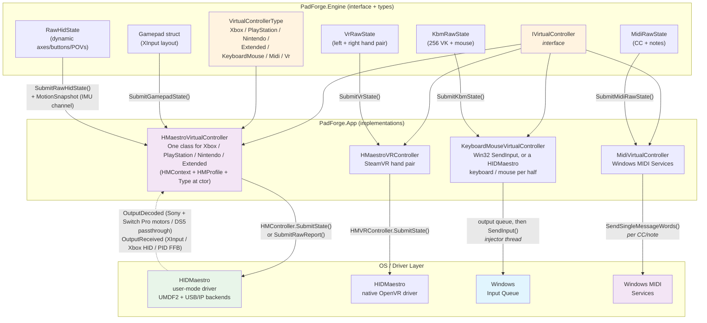

<!-- https://padforge.org/docs/features/virtual-controllers/ as PadForge's skill carries it, from padforge.org's wiki/features/virtual-controllers.md. -->
# Virtual Controllers

*Four classes, seven slot categories, one contract: how PadForge's virtual controllers submit state, decode feedback, and talk to their drivers.*

Developer reference for the four `IVirtualController` implementations in PadForge 6: HIDMaestro-backed (one class for the Xbox, PlayStation, Nintendo, and Extended categories), KeyboardMouse, MIDI, and VR. Covers state submission, axis/button mapping formulas, rumble/FFB, driver interaction, and type-specific quirks. The lifecycle layer that wraps these classes (off-polling-thread Connect/Disconnect, inactivity destroy, bubble-down cascade) lives on [HIDMaestro Deep Dive](https://padforge.org/docs/reference/hidmaestro-deep-dive/).

## Contents

- [Architecture Overview](#architecture-overview)
- [IVirtualController Interface](#ivirtualcontroller-interface)
- [HMaestroVirtualController](#hmaestrovirtualcontroller)
- [HMaestroVRController](#hmaestrovrcontroller)
- [KeyboardMouseVirtualController](#keyboardmousevirtualcontroller)
- [MidiVirtualController](#midivirtualcontroller)

---

## Architecture Overview



### Quick Comparison

| Property | Xbox / PlayStation / Nintendo / Extended | VR | KBM | MIDI |
|---|---|---|---|---|
| **Class** | `HMaestroVirtualController` | `HMaestroVRController` | `KeyboardMouseVirtualController` | `MidiVirtualController` |
| **Backend** | HIDMaestro: its UMDF2 user-mode driver, or its USB/IP backend for the profiles that must be USB devices (the composite Sony, Valve and Switch 2 Pro personas, the Steam Controller (2026), the two Joy-Con Charging Grip forms and Xbox One S Controller (Model 1708): Full) and for every profile on Windows on ARM64. PadForge leaves `HMBackend` at `Auto` | HIDMaestro's native OpenVR driver | Win32 SendInput (no driver), or a HIDMaestro keyboard or mouse for a half set to a model | Windows MIDI Services, else the legacy WinMM API |
| **Required driver** | HIDMaestro | HIDMaestro OpenVR driver plus SteamVR | None on Windows input, HIDMaestro for a half set to a model | None. Windows MIDI Services gives each slot its own port, and the legacy API sends to a picked one |
| **Submit methods** | `SubmitGamepadState(Gamepad)` for Xbox slots. A PlayStation overload adds touchpad / IMU / battery. `SubmitRawHidState(RawHidState, sticks, triggers)` (plus a `MotionSnapshot` overload) for Nintendo and Extended slots. `SubmitRawReport(ReadOnlySpan<byte>)` for the Sony USB Report 0x01 layout, the Valve personas' native frames and the SInput persona's report 0x01. `SubmitPackedExtendedReport(ReadOnlySpan<byte>)` for an Extended layout past 32 buttons or one hat | `SubmitVrState(in VrRawState)` | `SubmitKbmState(KbmRawState)` | `SubmitMidiRawState(MidiRawState)` |
| **Axis format at the SDK boundary** | `HMGamepadState.Axes` = `Dictionary<HMAxis, float>` normalized to [0, 1] (0.5 = stick center, 0 = released trigger). Y flipped to HID convention (up = 0.0) | `HMVRHandState` floats: sticks -1..1 (Y flipped to OpenVR's Y-up), trigger and grip 0..1 | short delta (mouse) | byte CC (0..127) |
| **Button format** | `HMButton` `[Flags]` enum. The raw path passes all 32 bits | `HMVRButton` flags, 8 bits per hand, identical by construction to `VrHandRaw.Buttons` | Per-VK `SendInput` | MIDI Note On/Off |
| **Rumble/FFB** | `HMController.OutputDecoded` (Sony and Switch Pro motors + DS5 effect passthrough) and `HMController.OutputReceived` (XInput / Xbox HID rumble, full PID FFB for Extended) | `HMVRController.HapticReceived`: OpenVR pulses fan into the slot's `Vibration` (left hand to left motor, right to right) with a per-hand expiry deadline | No | No |
| **Change detection** | Idle dedup with a 16 ms keepalive on the plain gamepad path, the raw HID path, and the packed Extended path. An identical frame inside the window is skipped, then re-published so the driver's stale watchdogs never trip. Changes always submit the same tick. A frame that carries a clock or a counter (the PlayStation overload, a raw frame with motion, and the packer frames `SubmitRawReport` takes) goes out on every pass up to 1000 passes a second. Above that, one that says nothing new waits until 0.75 ms after the last (`EveryPassFrameGate`). `PADFORGE_NO_RAWDEDUP=1` disables the raw-path dedup at launch (regression bisect switch). | Every pass up to 1000 passes a second, and the same spacing as the HM path above that (`EveryPassFrameGate`) | XOR per 64-bit word in the keymask | Per CC/note value |
| **Max instances** | 16 (across the four HM-backed categories combined, sharing the 16-slot total with KBM, VR, and MIDI) | 1 (`SettingsManager.MaxVrSlots`). One slot already drives both hands, and SteamVR tracks one pair, so a second would fight the first over the same two devices | 16 | 16 (`MaxMidiSlots = MaxPads`) |
| **Lifecycle** | HM `Connect()`/`Disconnect()` are off-polling-thread (wrapped in `Task.Run` by `Step5.VirtualDevices`). See [Lifecycle: Step 5 invariants](https://padforge.org/docs/reference/hidmaestro-deep-dive/#lifecycle-step-5-invariants) | Created on the same Step 5 `Task.Run` chain, because the first `Connect` registers the SteamVR driver. All calls are in-process over a named pipe inside `HIDMaestro.Core` | Created on the same Step 5 `Task.Run` chain. `Connect()` itself creates no device | Created on the same Step 5 `Task.Run` chain, and destroyed asynchronously every time. `Connect()` and `Disconnect()` carry their own timeouts |

**Source files:**
- `PadForge.Engine/Common/VirtualControllerTypes.cs`. `IVirtualController` interface + `VirtualControllerType` enum (`[XmlEnum("Sony")]` preserves the on-disk name "Sony" for v2 PadForge.xml back-compat) + `VirtualControllerGroups.InOrder` (the fixed seven-group visual order).
- `PadForge.Engine/Common/VrRawState.cs`. `VrHandRaw` / `VrRawState` plus the `VrLayout` mapping-key vocabulary.
- `PadForge.App/Common/Input/HMaestroVirtualController.cs`. Single class for all four HM-backed categories.
- `PadForge.App/Common/Input/HMaestroVRController.cs`. The SteamVR hand pair.
- `PadForge.App/Common/Input/KeyboardMouseVirtualController.cs`. Win32 SendInput, KbmRawState combine logic.
- `PadForge.App/Common/Input/MidiVirtualController.cs`. MIDI virtual controller lifecycle, over `MidiBackendInBox` (the in-box `Windows.Devices.Midi2`) or `MidiBackendAppSdk` (the App SDK runtime) as `MidiApiSelection` picks, else `MidiBackendLegacy` (the legacy WinMM API, `MidiBackendLegacy.cs`).

The lifecycle code that creates / destroys / reorders these instances per slot lives in `PadForge.App/Common/Input/InputManager.Step5.VirtualDevices.cs` and is documented under [HIDMaestro Deep Dive#Lifecycle Step 5 invariants](https://padforge.org/docs/reference/hidmaestro-deep-dive/#lifecycle-step-5-invariants) (HM thread pool, inactivity timeout, bubble-down cascade for mid-stack destroys, etc.).

---

## IVirtualController Interface

```csharp
namespace PadForge.Engine
{
    public enum VirtualControllerType
    {
        [XmlEnum("Microsoft")] Xbox = 0,         // on-disk alias preserves v2 PadForge.xml
        [XmlEnum("Sony")]      PlayStation = 1,  // on-disk alias preserves v2 PadForge.xml
        Extended = 2,
        Midi = 3,
        KeyboardMouse = 4,
        Nintendo = 5,  // appended after KeyboardMouse. Numeric values persist, never reorder
        Vr = 6         // appended after Nintendo, same rule
    }

    public interface IVirtualController : IDisposable
    {
        VirtualControllerType Type { get; }
        bool IsConnected { get; }

        /// The pad slot index this VC currently occupies. Updated by SwapSlotData
        /// so feedback callbacks write to the correct VibrationStates element
        /// after a slot reorder.
        int FeedbackPadIndex { get; set; }

        void Connect();
        void Disconnect();
        void SubmitGamepadState(Gamepad gp);
        void RegisterFeedbackCallback(int padIndex, Vibration[] vibrationStates);
    }
}
```

**Defined in:** `PadForge.Engine/Common/VirtualControllerTypes.cs`

`Nintendo = 5` is a console-family category like Xbox and PlayStation (own bucket, icon, fixed catalog profile) that rides the raw-HID data path. It has no Customize surface: the slot always deploys the catalog profile as-is.

`Vr = 6` is the SteamVR hand pair (issue #49). One slot drives both hands through one `HMaestroVRController`. It has no per-slot config: the driver ships one identity and haptics fan out like game rumble.

The same file defines `VirtualControllerGroups.InOrder` (`VirtualControllerTypes.cs:62-74`), the seven user-facing groups in fixed visual order: Xbox, PlayStation, Nintendo, Extended, KeyboardMouse, Midi, Vr. The order matches the sidebar and Home and is not user-reorderable. Each group is independent: operations on one must not affect any other.

### Gamepad Struct (Input Contract)

XInput-layout struct used as the universal input format for the Xbox and PlayStation categories (and for Extended slots' gamepad-shaped intermediate in Steps 3-4). `HMaestroVirtualController.SubmitGamepadState` translates it to `HMGamepadState`. The KBM and MIDI implementations leave `SubmitGamepadState` as a no-op and read `KbmRawState` / `MidiRawState` directly through their own submit methods.

| Field | Type | Range | Description |
|---|---|---|---|
| `ThumbLX` | `short` | -32768..32767 | Left stick X (positive = right) |
| `ThumbLY` | `short` | -32768..32767 | Left stick Y (positive = up) |
| `ThumbRX` | `short` | -32768..32767 | Right stick X (positive = right) |
| `ThumbRY` | `short` | -32768..32767 | Right stick Y (positive = up) |
| `LeftTrigger` | `ushort` | 0..65535 | Left trigger (unsigned) |
| `RightTrigger` | `ushort` | 0..65535 | Right trigger (unsigned) |
| `Buttons` | `ushort` | Bitmask | 16 bit-constants `0x0001`..`0x8000`: DPad (Up/Down/Left/Right), Start, Back, LS, RS, LB, RB, Guide, Touchpad (`0x0800`, PlayStation slots, used by macros), A, B, X, Y |
| `Share` | `bool` | true/false | Xbox Series Share button. Separate field because all 16 `Buttons` bits are taken. HM exposes it as `HMButton.Share` on Xbox Series profiles |
| `MicMute` | `bool` | true/false | DualSense mic mute (wire bit `0x04` of the third buttons byte). SDL calls this misc1 on PS5 pads, and HM carries it as `HMButton.Misc1` |
| `LeftPaddle`, `RightPaddle` | `bool` | true/false | DualSense Edge back paddles (wire bits `0x40` left, `0x80` right) |
| `LeftFunction`, `RightFunction` | `bool` | true/false | DualSense Edge front Fn buttons (wire bits `0x10` left, `0x20` right), which SDL exposes as LEFT_PADDLE2 / RIGHT_PADDLE2 |

All six bool extras are set unconditionally. Since HM v1.5.1 the buttonMaps carry an explicit -1 for bits a profile does not declare, which is what ended the identity fallthrough that had Share pressing PS on every Sony pad.

### FeedbackPadIndex

Tracks which slot this VC occupies for correct `VibrationStates[]` writes. The runtime writers are `RegisterFeedbackCallback` (sets the initial index), `RetargetToPad` (`HMaestroVirtualController.cs:701`, invoked by `InputManager.RerouteVirtualControllersForReorder` at `InputManager.Step5.VirtualDevices.cs` on intra-group reorder, which also rebuilds the DS5 passthrough and user-effects dispatchers against the new pad), and `UnregisterFeedback` (`HMaestroVirtualController.cs`, parks the index at -1 on destroy so late driver callbacks no-op). The feedback handler reads the property on every callback (not a captured copy), so it always resolves the current slot index after a reorder. The interface docstring still names a `SwapSlotData` updater. No such method exists in the codebase.

### Type-Specific Submit Methods

All implementations have `SubmitGamepadState(Gamepad gp)` for interface compliance, but the non-gamepad outputs use alternative submit methods and leave it as a no-op:

- **Xbox:** `SubmitGamepadState(Gamepad gp)` (`HMaestroVirtualController.cs:884`). Standard XInput-shaped path.
- **PlayStation:** the extended overload `SubmitGamepadState(gp, in TouchpadState, in MotionSnapshot, byte batteryPercent, bool batteryCharging, in ButtonPressureState)` (`HMaestroVirtualController.cs:996`) carries the Sony sensor / battery payload and the DualShock 3 button pressures alongside the gamepad state.
- **PlayStation (DS4/DS5 USB report):** `SubmitRawReport(ReadOnlySpan<byte> report)` (`HMaestroVirtualController.cs:777`). Sony Report 0x01 carrying touchpad / gyro / accel / battery.
- **Nintendo and Extended (raw HID surface):** `SubmitRawHidState(RawHidState raw, int sticks, int triggers)` (`HMaestroVirtualController.cs:1180`) plus an overload taking `in MotionSnapshot` that feeds the HM v1.3.18 IMU channel. Up to 8 axes, 32-bit button mask, 1 hat. This path carries profile-specific button bits beyond the named set and arbitrary per-profile axis layouts that the fixed `Gamepad` struct can't express.
- **Extended past 32 buttons or one hat:** `SubmitPackedExtendedReport(ReadOnlySpan<byte> report)` (`HMaestroVirtualController.cs:1503`). When `ExtendedReportPacker.NeedsRawReport(layout)` is true, Step 5 packs the frame against the descriptor the slot's own build emitted (up to 128 buttons and 4 hats) and submits it raw, with the same 16 ms idle dedup.
- **VR:** `SubmitVrState(in VrRawState raw)` (`HMaestroVRController.cs:196`). The left + right hand pair for one slot.
- **KeyboardMouse:** `SubmitKbmState(KbmRawState raw)`. Keys, mouse, scroll.
- **MIDI:** `SubmitMidiRawState(MidiRawState state)`. CC values and note on/off.

---

## HMaestroVirtualController

**Namespace:** `PadForge.Common.Input`
**Visibility:** `internal sealed`
**File:** `PadForge.App/Common/Input/HMaestroVirtualController.cs`
**Backs:** `VirtualControllerType.Xbox`, `.PlayStation`, `.Nintendo`, `.Extended`
**Max instances:** 16 (`MaxPads`, `InputManager.cs:119`). HM-backed slots share that 16-slot pool with KBM, VR, and MIDI. Xbox-category slots are visible to XInput games as user index 1 through 4 (Microsoft API limit). SDL / DirectInput games see all of them.

One `IVirtualController` implementation handles every preset and every custom HID descriptor through a single SDK surface: `HMContext` + `HMProfile` + `HMController`. The user-facing category (Xbox / PlayStation / Nintendo / Extended) is supplied at construction so per-type counting in `InputManager` and `InputService` keeps working. The actual driver-side device shape is determined by the supplied `HMProfile`.

For lifecycle invariants that wrap this class (off-polling-thread Connect/Disconnect, inactivity-destroy timeout, bubble-down cascade on mid-stack destroy), see [HIDMaestro Deep Dive#Lifecycle Step 5 invariants](https://padforge.org/docs/reference/hidmaestro-deep-dive/#lifecycle-step-5-invariants). This page covers only the controller class itself.

### Nintendo category (issue #246)

New in 4.1.0. A virtual Nintendo Switch Pro Controller as a first-class slot category beside Xbox and PlayStation, shown in the UI as **Nintendo** and backed by HIDMaestro v1.3.18's functional Switch Pro (HIDMaestro#33: USB init replies, subcommand request-reply state machine, 60 Hz report-0x30 streaming, HD-rumble decode).


| Aspect | Behavior |
|---|---|
| **Preset** | Four catalog profiles: `switch-pro` (VID 0x057E, PID 0x2009), `switch-pro-usb` (the same pad on its USB descriptor, HIDMaestro 2.0.0, which sends its 0x30 report every 15 ms once a host starts it with the USB handshake), `switch2-pro-controller` (VID 0x057E, PID 0x2069, a UMDF2 HID gamepad) and `switch2-pro-controller-composite` (the same pad as a two-interface USB/IP persona, HIDMaestro 1.11.0). `HMaestroProfileCatalog.NintendoProfiles` filters on `IsNintendoProfile` (`HMaestroProfileCatalog.cs:694`), an explicit id list. The Joy-Cons, the NSO retro pads in both their forms, and the GameCube adapter's HID form stay in the Extended category, and the adapter's Full persona is withheld. `DefaultNintendoProfileId` (`InputManager.Step5.VirtualDevices.cs`) seeds new slots with `switch-pro`. |
| **Creation** | `CreateVirtualController` routes Nintendo through `CreateHMaestroController` (`InputManager.Step5.VirtualDevices.cs`), same as the other HM categories. No Customize surface: the profile-override branch in `CreateHMaestroController` gates on `type == Extended`, so a Nintendo slot always deploys the catalog profile as-is. Reorder rerouting includes the Nintendo group. |
| **Data path** | The raw HID surface. `SlotRawHidSurface` is true for both Extended and Nintendo slots (`InputService.cs`), so Step 3/4 produce `RawHidState` and Step 5 submits via `SubmitRawHidState` with the slot's `MotionSnapshot` riding beside it (`InputManager.Step5.VirtualDevices.cs:2449-2456`). `switch-pro`, `switch-pro-usb` and the composite run a protocol of their own in HIDMaestro, so their frames go out on `HMaestroSubmitLane` (see [Submit lane](#submit-lane)). On a Switch 2 Pro profile the frame's rows go through `Switch2ProStateMap` on the way (see [Switch 2 Pro state](#switch-2-pro-state)). |
| **Gyro passthrough** | The `MotionSnapshot` overload fills the HM v1.3.18 IMU channel: `AccelGX/GY/GZ` (g) and `GyroDpsX/Y/Z` (deg/s) land verbatim in the SDL sensor frame (`HMaestroVirtualController.cs:1442-1450`). The profile's own report program owns the wire frame and scale, so the vector round-trips bit-consistent to SDL on the client. Zeroes when the slot maps no motion source and no [Motion Pitch, Yaw or Roll](mappings.md#motion-pitch-yaw-and-roll) row. `switch-pro`, `switch-pro-usb` and `switch2-pro-controller-composite` carry it. Since HIDMaestro 2.0.0 each profile's JSON carries its protocol: the Switch Pro's report 0x30 with the IMU and its rumble decode in `switch-pro` and `switch-pro-usb`, and the Switch 2 Pro's report 0x05 with the six motion counts in the composite. The plain `switch2-pro-controller` profile's report 0x09 carries no motion field (`HMaestroProfileCatalog.ReportCarriesNoMotion`). |
| **Rumble** | On `switch-pro` and `switch-pro-usb`, HIDMaestro's SDK decodes the game's 0x01/0x10 HD-rumble writes itself, through the profile's rumble decoder, and emits `leftMotor` / `rightMotor` on `OutputDecoded` only for genuine rumble frames. On `switch2-pro-controller-composite` the SDK decodes output report 0x02 into the same two fields, and a stop arrives as 0, 0. The plain `switch2-pro-controller` gets no rumble decode. `MotorWriteAllowed` keeps non-Sony vendors on unconditional trust (the validity-flag semantics are Sony's), and a dedicated `NintendoVid` (0x057E) branch feeds the [inbound game-feedback pack](#inbound-game-feedback-pack-issue-236) for Bass Shakers. |
| **Button lettering** | Nintendo slots keep the raw Numbered value space and re-letter labels per raw index through the active profile's wire table (`NintendoPreviewMap.ButtonTable`, read by `MacroItem.cs` `NintendoLetteredLabel`). The `switch-pro` table is B A Y X, L R, ZL ZR, Minus Plus, stick clicks, Home, Capture (`NintendoExtendedLabel`). Its descriptor's gamepad report (0x3F) declares 16 buttons, but only the 14 role-mapped indices reach the wire (`NintendoLetteredButtonCount`). The Switch 2 Pro table, which both of its profiles share, has 21: the D-pad rides four discrete buttons, and GR, GL and C follow Capture. ZL/ZR digital clicks ride `TriggerClickButtonMask`, derived from the profile layout's trigger-click roles (`InputService.TriggerClickButtonMaskFrom`, `InputService.cs`). |
| **Preview** | Both views, like Xbox and PlayStation. 3D is the Switch 2 Pro mesh, shared with the `switch2-pro` profiles (`HMaestroProfileCatalog.ResolveAssetFolders` maps `switch-pro` to the `Switch2Pro` model and its own `SWITCHPRO` 2D set). The S2-only parts render inert on an original Pro Controller. |
| **Readers** | `switch2-pro-controller-composite` sends nothing until a host starts it over its bulk interface, as the real pad does. Steam and SDL built with libusb do. DirectInput, RawInput, Windows.Gaming.Input and browsers read nothing from it, so `switch2-pro-controller` stays the profile for them and `switch-pro` stays the default. |
| **HOME LED** | Physical Switch pads assigned to the slot take Guide LED brightness through the "Guide Button LED" card in the controller page's Lights & Sound section ("Device Default" / "Fixed Brightness" / "Battery Level"). The writer is per device, SDL `SDL_SetJoystickLED`, which the Switch HIDAPI driver converts to a subcommand 0x38 Set HOME Light packet with 15 nonzero intensity steps (`SwitchHomeLedSetter.cs`). Works on any connection. This lane is device-scoped, not VC-scoped: it drives the physical pad's LED whatever the slot type. |

Acceptance was hardware-verified: SDL3's `HIDAPI_DriverSwitch` opens the virtual pad, completes init, reads calibrated sticks and buttons, reports gyro + accel through `SDL_GetGamepadSensorData`, and Steam Input shows a Pro Controller with Nintendo glyphs.

### Valve personas (issues #337 / #338)

New in 4.4.0. Five HIDMaestro profiles in the **Extended** category present as Valve hardware, and Steam and any SDL game read the real device's USB identity. Four of them submit that device's own input frame instead of the field-encoded raw surface. The plain Steam Deck Controller sends the field-encoded surface.


| Profile id | Catalog name | USB identity | Presents as |
|---|---|---|---|
| `steam-controller` | Steam Controller (Wired) | 28DE:1102 | One vendor-page HID interface, 64-byte reports |
| `steam-controller-composite` | Steam Controller (Composite) | 28DE:1102 | The wired 2015 pad's whole USB configuration: lizard-mode mouse, boot keyboard, vendor controller on interface 2 |
| `steam-controller-2` | Steam Controller (2026) | 28DE:1302 | One HID interface carrying everything by report id: mouse 0x40, keyboard 0x41, controller state 0x42 |
| `steam-deck` | Steam Deck Controller | 28DE:1205 | A plain HID gamepad descriptor, 6 axes / 21 buttons / 1 hat |
| `steam-deck-composite` | Steam Deck Controller (Composite) | 28DE:1205 | The Deck's five-interface configuration, down to the CDC ACM pair |

Ids, names and USB identities are HIDMaestro's, from the profile JSON embedded in `HIDMaestro.Core.dll` (`HIDMaestro.Profiles.valve\*.json`). `steam-controller-composite`, `steam-controller-2` and `steam-deck-composite` run on HIDMaestro's USB/IP backend, because the identity Steam inspects is the whole configuration rather than the controller interface alone. No Valve id is in `HMaestroProfileCatalog.WithheldProfileIds`, and `ValveProfileArtworkTests` fails the build if one is put back into it. Since HIDMaestro 2.0.0 the set holds the GameCube adapter's Full persona alone.

Valve's CAD is CC BY-NC-SA 4.0, Copyright Valve Corporation. PadForge is not associated with or endorsed by Valve.

**What a client sees.** On a headless bench, stock SDL3 with `SDL_JOYSTICK_HIDAPI_STEAM=1` claimed `steam-controller-composite` as "Steam Controller" with two touchpads, gyro and accelerometer, and a live Steam client opened it, reserved XInput slot 0, took the input stream and loaded the `gordon` configuration set. Nothing has run against real Valve hardware.

#### Native input frames

`ValveReportPackers` (`PadForge.App/Common/Input/ValveReportPackers.cs`) packs the slot's `RawHidState`, `TouchpadState` and `MotionSnapshot` into the device's own report. Step 5 asks `ValveReportPackers.ForProfile(profileId)`, and when it gets a packer it submits the first `valvePacker.Size` bytes of `_deckReportScratch` through `SubmitRawReport` instead of `SubmitRawHidState` (`InputManager.Step5.VirtualDevices.cs`).

| Profile | Report | Size | Source |
|---|---|---|---|
| `steam-deck-composite` | `ValveInReport` type 0x09, header `01 00 09 40` | 64 | SDL `controller_structs.h` `SteamDeckStatePacket_t` plus `SDL_hidapi_steamdeck.c` |
| `steam-controller`, `steam-controller-composite` | `ValveInReport` type 0x01, header `01 00 01 3C` | 64 | SDL `SDL_hidapi_steam.c` masks 118-140, `ValveControllerStatePacket_t` |
| `steam-controller-2` | Report `0x42`, `TritonMTUFull_t` | 54 | SDL `controller_structs.h`, cross-checked against sc2-research `docs/HID_REPORT_FORMAT.md` |

Both 2015 profiles share one frame: the plain UMDF2 profile exposes the wired controller's 64-byte vendor report, and the composite persona's extended report is that same `ValveInReport`. Plain `steam-deck` has no packer and rides `SubmitRawHidState` like any other Extended profile.

Every slot in a frame resolves through `NintendoPreviewMap.IndexOf(profileId, role)`, so the packers, the mapping grid, the labels and the preview bridge all read one table. Four frame details the structs do not give away:

- **Packet number.** `unPacketNum` advances on every submit. SDL's own struct comment licenses a consumer to skip a frame whose number has not changed, so a constant freezes it.
- **Triggers.** The engine stores a trigger bipolar, rest at `short.MinValue`. Every Valve wire carries it unsigned 0..32767, which SDL decodes back with `* 2 - 32768`, so the packers rescale with `(raw + 32768) / 2`. An earlier clamp to `[0, 32767]` got rest and full pull right and read the whole lower half of the travel as zero.
- **Deck View and Menu.** `STEAMDECK_LBUTTON_VIEW` is bit 12 and `_MENU` is bit 14 (`SDL_hidapi_steamdeck.c:61-63`). The Deck packer had the two swapped and its own test pinned the swap. `ValveWireTests.Packer_PutsEveryNamedSpecButtonOnItsBit`, which reads HIDMaestro's `ExtendedReport` spec off the SDK, found it.
- **IMU.** `MotionSnapshot` maps into the Valve sensor frame as accel `(X, -Z, Y)` and gyro `(pitch, -roll, yaw)` on the Deck and the 2026 pad, and gyro `(pitch, roll, yaw)` on the 2015 pad, whose SDL driver reads that word as +Y where the other two read -Y (`SDL_hidapi_steam.c:1684-1686`, `SDL_hidapi_steamdeck.c:250-257`, `SDL_hidapi_steam_triton.c:294-301`). The 2015 frame once carried roll negated. Both scale to +/-2 g and +/-2000 deg/s. The quaternion field stays zero, because the slot has no fused orientation. The 2026 frame's IMU timestamp at byte 30 is microseconds, read from `Stopwatch` as the frame is handed over (`ValveReportPackers.MicrosNow`), since SDL advances its sensor clock by the difference between two frames' words (`SDL_hidapi_steam_triton.c:289-292`). It once carried the frame counter, so SDL's sensor clock ran about a thousand times slow.
- **Trigger clicks.** The Deck and the 2026 pad set their digital trigger bits at 90 percent of the pull, 29490 of 32767 on the wire, the default in Valve's firmware that HIDMaestro 2.0.2 carries as `triggerThreshold` (`ValveReportPackers.TriggerClickPull`). The 2015 pad sets them where its 8-bit trigger byte reads 255, its end of travel. Every packer once set them at any travel, so a light pull fired a Steam Input full-pull binding.
- **Pad pressure.** The Deck (bytes 56 and 58) and the 2026 pad (bytes 22 and 28) carry 32767 while a pad is touched or clicked and 0 otherwise. SDL divides the word by 32768 (`SDL_hidapi_steamdeck.c:272, 284`, `SDL_hidapi_steam_triton.c:273, 285`), so a press reads as full pressure. The frames once wrote 0xFFFF on a click, which SDL read as 2.0, and 0 on a touch.

**Report clock and unit serials (HIDMaestro 2.0.2).** The three personas report on their own clock, as the hardware does: the Deck and the 2026 pad every 4 ms and the 2015 pad every 9 ms. PadForge still submits a frame every engine tick, and each report carries the latest one. A persona created with an identity key, as PadForge creates them, answers a unit serial of its own, so Steam files a PadForge Deck or 2026 controller under new settings once. To keep a layout made under the old serial, copy `configset_FX1A00000001.vdf` and `preferences_FX1A00000001.vdf` (`FXA9960200001` for the 2026 controller) in `Steam\steamapps\common\Steam Controller Configs\<account>\config` to the new serial's names, which Steam's `logs\controller.txt` shows.

The capacitive sensors ride rows appended to the wire tables, so saved bindings keep their slots. The Deck frame packs Left and Right Stick Touch into `ulButtonsH` at 0x4000 and 0x8000, byte 13 bits 0x40 and 0x80 (`SDL_hidapi_steamdeck.c`), and the 2026 frame packs Right Stick, Left Stick, Right Grip and Left Grip Touch at button bits 20, 24, 28 and 29 (`SDL_hidapi_steam_triton.c`). HIDMaestro 1.12.0 names the same bits. The plain `steam-deck` profile has no packer, so there the two stick rows are buttons 19 and 20 of its HID gamepad report.

#### Descriptors that lead with a mouse

The 2026 pad carries its lizard-mode mouse (report 0x40) and keyboard (0x41) ahead of its controller state (0x42) on one interface. `HMController.SubmitRawReport` takes data bytes only and the driver prepends the descriptor's first report id, so a 54-byte 0x42 frame shifted one byte and came back out as a mouse report. The rolling sequence number landed on relative X at 250 Hz and the cursor tore sideways until the slot was deleted.

HIDMaestro v1.7.1 fixed it (HIDMaestro#58): a profile that declares an input report id and is always armed now emits verbatim. `HMaestroVirtualController` resolves that pairing once at construction into `_extendedFrameCarriesItsOwnId` and calls `SubmitRawExtendedReport`, rather than letting the driver infer it from frame length, where a one-byte change to either size would flip the branch silently (`HMaestroVirtualController.cs:336-337` and `HMaestroVirtualController.cs:797-800`).

`HMaestroProfileCatalog.LeadsWithAPointingReport` parses a descriptor and returns true when its first input report sits in a Generic Desktop Mouse or Keyboard collection. It is a tripwire. Nothing in the app refuses a profile on it, and `PointingReportProfileGuardTests` uses it to require that every pointing-led profile carrying a packer is on the verbatim path.

#### Mapping grid

Valve slots keep the raw surface, and their rows carry Valve's own control names instead of "Button N". Labels come from `MacroButtonNames.ValveRoleLabel` (`MacroItem.cs`) over the family's wire table.

Axes interleave as `[LX LY LT RX RY RT]`, which is what `ComputeAxisLayout` produces for two sticks and two analog triggers. The Nintendo families pack `[LX LY RX RY]`, having no analog triggers at all.

Buttons get one index space per family, all of them in `NintendoPreviewMap`:

| Family | Wire order |
|---|---|
| `SteamDeck` (`steam-deck`, `-composite`) | A B X Y, L1 R1, View Menu, L3 R3, Steam, Quick Access, R4 L4 R5 L5, Left Pad Click, Right Pad Click, Left Stick Touch, Right Stick Touch. D-pad is a hat |
| `SteamController` (`steam-controller`, `-composite`) | A B X Y, L1 R1, Back Start, L3, Steam, Left Grip, Right Grip, Left Pad Click, Right Pad Click. D-pad is a hat, and it is the left trackpad's quadrant bits |
| `SteamController2` (`steam-controller-2`) | A B X Y, L1 R1, View Menu, L3 R3, Steam, Quick Access, R4 L4 R5 L5, Left Pad Click, Right Pad Click, then the D-pad as four discrete buttons, then Left Stick Touch, Right Stick Touch, Left Grip Touch, Right Grip Touch |

Row strings live in `Strings.resx`: `Btn_View`, `Btn_Menu`, `Btn_Steam`, `Btn_QuickAccess`, `Btn_LeftGrip`, `Btn_RightGrip`, `Btn_LeftPadClick`, `Btn_RightPadClick`, plus `Mapping_LeftPadX` / `Y` / `Touch` and their right-pad twins. R4, L4, R5 and L5 are printed on the hardware, so they are literals and are not localized.

The 2015 pad has one physical stick and rides its right trackpad as the right stick, which is why `StickCount` is 2 on every family. Its right pad click is one wire bit doing two jobs: SDL reports it as `SDL_GAMEPAD_BUTTON_RIGHT_STICK` (`SDL_hidapi_steam.c:1613`) and as the right pad's click on the touchpad surface (`:1663`), both from `STEAM_BUTTON_RIGHTPAD_CLICKED_MASK`. The table names the slot once as `RightTouchpadClick`, and `NintendoPreviewMap.Aliases` lets `RightThumbButton` reach the same row.


#### Both trackpads

`InputManager.SlotCarriesTouchpad(slot)` (`InputManager.cs:321`) is true for every PlayStation slot, and for an Extended slot on a raw surface whose profile is Valve or SInput. Step 3 computes the touch surface and Step 4 combines it only when it is true. Before that predicate existed both steps gated on PlayStation alone, so every Valve packer received a zeroed `TouchpadState` and no pad on a virtual Deck or Steam Controller could be touched.

Every Valve frame carries one finger per pad, so the slot's two-finger `TouchpadState` splits as finger 0 = left pad, finger 1 = right pad (`ValveReportPackers.Pads`). The grid lists Left / Right Pad X, Y and Touch on those two fingers. Pad clicks stay raw buttons, so a Valve grid has no `TouchpadClick` row. A click arriving with no per-pad source lands on whichever pad is touched, and on the left pad when neither is.

Automap binds the advertised gamepad buttons for the two clicks: "Button 16" is SDL's `TOUCHPAD` (`touchpad:b17`, the left click) and "Button 17" is `MISC2` (`misc2:b16`, the right). The pressure descriptors are the fallback for a pad that advertises neither, which is the 2015 controller. A slot automapped by an earlier build keeps its old rows until the pad is reassigned.

#### Switching Extended profiles

The three Valve wires share almost no indices, so a profile change has to move the existing bindings and then fill what the new wire added. The `PadViewModel.ProfileId` setter does both (`PadViewModel.cs`):

1. **Translate.** `SettingsManager.TranslateNintendoRawMappings` moves everything the slot names by a raw position, by role: the rows of every layer (`MoveRawRows`), each device's raw mappings with the deadzone and Bidirectional entries kept under the same target (`MoveRawEntries`), and the buttons the SOCD pairs name (`MoveSocdPairs`). A pair with a button the new wire lacks is dropped. Where two rows of one layer land on one target, the first with a source keeps it. Deck to 2015 without it left Steam on `RawBtn10`, which is the left grip over there, and a left pad click on `RawBtn16`, past the end of that 14-button wire. Both sides must be lettered: `NintendoPreviewMap.ButtonTable` falls back to the Switch Pro table for an id it does not know, so a numbered Extended profile is never translated.
2. **Automap the additions.** `DeviceService.FillEmptyAutoMappingsForSlot` fills the targets the outgoing wire never had. The 2026 pad's D-pad is four discrete buttons at 18-21 and the Deck's wire ends at 17. The fill is additive, so a binding the user authored or deliberately cleared on this wire survives.

Both halves key on the wire stamp, never on the setter's previous value. Every restore, apply and import path calls `SettingsManager.StampNintendoWire` before assigning the view model, so `stamp == incoming` means the data already belongs to that profile and neither step runs. Creating a slot stamps its profile, a type change stamps the new category's default before it assigns the profile, deleting a slot clears its stamp, and an unknown stamp adopts the next profile assigned without moving anything. `PadForge.Tests/ValveProfileSwitchTests.cs` pins it.

A Valve slot also draws its own body instead of the Extended schematic. `PadPage`'s Extended test defers to `HMaestroProfileCatalog.HasDedicatedArt` (`PadPage.xaml.cs:788-808`), and a profile change re-runs `ApplyViewMode`. The meshes are covered on [3D Model System](https://padforge.org/docs/reference/3d-model-system/).

### SInput persona (issue #584)

New in 6.0.0. The **SInput Gamepad** (`sinput`, HIDMaestro 2.2.0, HIDMaestro#75) is Hand Held Legend's SInput pad at 2E8A:10C6, in the **Extended** category. It answers the features command SDL's SInput driver sends before it opens a pad, so SDL opens it as SInput: two sticks, two analog triggers, two touchpads, an accelerometer, a gyroscope and the rear buttons.

`SInputReportPacker` (`PadForge.App/Common/Input/SInputReportPacker.cs`) packs the slot's `RawHidState`, `TouchpadState` and `MotionSnapshot` into report 0x01, 64 bytes with its ID, the frame SINPUT-LIB-HID builds and SDL's `SDL_hidapi_sinput.c` reads. Step 5 sends it through `SubmitRawReport` in place of `SubmitRawHidState`, as it sends a Valve frame. The profile declares no always-armed report id, so Step 5 hands over the 63 bytes after the ID and the driver puts 0x01 back (`RawFramesCarryReportId`). The frame carries:

- The plug status and charge percent from the slot's devices. A slot whose devices report no battery sends plug status 0, which SDL reads as no power state.
- The buttons in the wire's bit order, south button at bit 0. The digital trigger bits set at the pull the Valve packers use, `ValveReportPackers.TriggerClickPull`.
- The sticks and triggers as signed 16-bit values, Y down-positive as the raw surface already is.
- The IMU timestamp in microseconds (`ValveReportPackers.MicrosNow`), and the accelerometer and gyroscope at the ranges the persona's feature reply advertises, ±8 g and ±2000 deg/s, rotated out of SDL's frame.
- One finger per touchpad, finger 0 on the left pad and finger 1 on the right, as on a Valve frame.

The grid rows are the Valve roles (`NintendoPreviewMap.UsesValveRoles`): A B X Y, the D-pad as four discrete buttons, L3 R3, L1 R1, L4 R4, Start, Back, Guide, Share, L5 R5, and the two touchpad clicks. Share sits on misc 1, where a Valve wire has Quick Access (`NintendoPreviewMap.GamepadPositions`), so the automap, Paste and Copy From carry an Xbox pad's Share and a DualSense's mic button there. Like a Valve slot, an SInput slot carries its touchpads (`InputManager.SlotCarriesTouchpad`), and Customize keeps its descriptor (`fixedWireFrame` in `CreateHMaestroController`).

HIDMaestro decodes the persona's haptics into `leftMotor` and `rightMotor` on `OutputDecoded`: a type 2 write's bytes 3 and 5, and the louder amplitude per side of a type 1 write. A stop is a type 2 write of 0, 0. `HMaestroVirtualController.DecodesSInputMotors` names the two profiles that decode this way, `sinput` and `joypad-steam-input` (Joypad-OS Steam Input Gamepad, the same 2E8A:10C6, which HIDMaestro 2.2.0 also lets SDL open). Their slots pass game rumble to the slot's controllers and into the [inbound game-feedback pack](#inbound-game-feedback-pack-issue-236), and the Bass Shakers card shows for them without a PID block (`DecodesFeedbackWithoutPidBlock`). `joypad-steam-input` has no packer and rides `SubmitRawHidState`. Both run a protocol in HIDMaestro, so their frames go out on the [submit lane](#submit-lane).

### Profiles added in HIDMaestro 2.3.0

HIDMaestro 2.3.0 adds six profiles, and PadForge offers all six with no code change:

| Profile id | Catalog name | Category | USB identity |
|---|---|---|---|
| `xbox-one-s-full` | Xbox One S Controller (Model 1708): Full | Xbox | 045E:02EA |
| `genesis-nso-usb` | Sega Genesis Controller (Nintendo Switch Online) (USB) | Extended | 057E:201E |
| `n64-nso-usb` | N64 Controller (Nintendo Switch Online) (USB) | Extended | 057E:2019 |
| `snes-nso-usb` | SNES Controller (Nintendo Switch Online) (USB) | Extended | 057E:2017 |
| `joycon-l-usb` | Nintendo Switch Joy-Con Charging Grip with Joy-Con (L) | Extended | 057E:200E |
| `joycon-r-usb` | Nintendo Switch Joy-Con Charging Grip with Joy-Con (R) | Extended | 057E:200E |

Ids, names and identities are HIDMaestro's, read from the bundled DLL's catalog. `xbox-one-s-full` is a wired GIP pad that Windows' own Xbox drivers bind. It carries no HID descriptor, and it and the two Charging Grip forms run on HIDMaestro's USB/IP backend on x64 as well as on ARM64. The Joy-Cons and the Nintendo Switch Online pads, in both their Bluetooth and USB forms, answer the Switch protocol's subcommands, so SDL opens them.

These six, the Bluetooth forms of the Joy-Cons and the Nintendo Switch Online pads, `switch-pro`, `switch-pro-usb`, `dualshock-3-full` and the Switch 2 Pro composite build their own reports from a state block (`HMProfile.BuildsItsOwnReports`, 15 offered profiles). `HMaestroVirtualController.DeviceBuildsReports` reads the property, so such a slot submits state and never a packed frame, and the set is pinned in `Switch2ProCompositeTests`. PadForge has not driven any of the six in a live check, and has not driven any Bluetooth profile on the USB/IP backend.

### Fields

| Field | Type | Description |
|---|---|---|
| `_ctx` | `HMContext` | Shared HM SDK context owned by `InputManager` (`InputManager.Step5.VirtualDevices.cs:101`, `_hmaestroContext`). One instance per process. |
| `_profile` | `HMProfile` | Profile handle resolved via `_hmaestroContext.GetProfile(profileId) ?? HMaestroProfileCatalog.GetProfileById(profileId)`, optionally rebuilt via `HMProfileBuilder.FromProfile` for descriptor overrides (Extended + Customize only). |
| `_cachedProfileSticks`, `_cachedProfileTriggers` | `IReadOnlyList<HMSimpleStick/Trigger>` | Ctor-cached layout lists. `HMProfile.Sticks` / `.Triggers` allocate fresh lists per access, and the raw submit path read both per 1 kHz tick (~115 KB/s in the allocation trace). Layout is immutable per profile. |
| `_type` | `VirtualControllerType` | Reported through `Type` so `SlotControllerTypes`-based counting keeps working. |
| `_identityKey` | `string` | The durable identity key handed to HIDMaestro (1.8.0, HM#60), or null. See [Constructor](#constructor). |
| `_controller` | `HMController` | Live HM device returned by `_ctx.CreateController(_profile, _identityKey)`. Null until `Connect()`. |
| `_target`, `_lane` | `IHMaestroSubmitTarget`, `HMaestroSubmitLane` | Where every submit goes: the controller itself (`HMControllerSubmitTarget`), or the [submit lane](#submit-lane) in front of it for a profile whose submit can wait. Null until `Connect()` and from the start of `Disconnect()`, so a submit then does nothing. |
| `BuildsItsOwnReports` | `bool` | `HMProfile.BuildsItsOwnReports`, read once through `DeviceBuildsReports`. True for a profile that takes a state block and no finished frame. |
| `_ffbDecoder` | `HMaestroFfbDecoder` | Set when the active profile's HID descriptor contains a PID FFB block (`DescriptorHasPidFfbBlock(descriptorHex)` at `Connect()` time). Includes the synthetic Custom profile and any catalog profile whose FFB capability is wired via `HMProfileBuilder`. Null when the profile has no PID block. |
| `_fbVibrationStates` | `Vibration[]` | Cached feedback array from `RegisterFeedbackCallback`, read by `TickFfb()` for the per-tick PID re-evaluation on the engine clock. |
| `_ds5Dispatcher` | `DualSensePassthroughDispatcher` | Per-VC dispatcher forwarding DS5 effect messages (adaptive triggers, lightbar, audio, rumble) to the assigned physical DualSense. Created in `RegisterFeedbackCallback` only when `IsDualSenseVirtual`, and rebuilt by `RetargetToPad`. Torn down first in `Disconnect()`. |
| `_userEffectsDispatcher` | `UserEffectsDispatcher` | Synthesizes user-configured trigger / lightbar / audio effects from the attached `DeviceSlotConfig` and forwards them via `SDL_SendGamepadEffect`. Created by `PrepareDeviceEffectsForPublication` when Step 5 publishes the controller, or by `AttachDeviceConfig` when none exists. Torn down in `Disconnect()`. |
| `_dispatcherLock` | `object` | Orders `AttachDeviceConfig` (UI thread) against `Disconnect` (the poll thread's destroy pass) so a teardown cannot race an attach into a zombie dispatcher. `PrepareDeviceEffectsForPublication`, `ReApplyUserEffects` and `RetargetToPad` take it too. |
| `_inboundRumblePack` | `long` | Controller-local packed game-feedback state for the rumble-to-audio feature (issue #236). See [Inbound game-feedback pack](#inbound-game-feedback-pack-issue-236). |
| `_axLeftStickX` .. `_axRightTrigger` | `HMAxis` | Cached wire-axis keys for the profile's first two sticks and two triggers, resolved once at construction from `_profile.AxisMap` so the 1 kHz hot path avoids re-walking the layout lists. `HMAxis.None` means the slot doesn't exist on the profile and the hot path skips it. |
| `_axLeftTriggerField`, `_axRightTriggerField` | `HMAxis` | Secondary mirror targets for the trigger rows' own wire-field keys (X360 reads triggers from Vx/Vy while its canonical positions are Z/Rz). `HMAxis.None` when they coincide with the canonical key. Both positions are written so every HM SDK lane reads live trigger values (discussion #130). |
| `_axesScratch` | `Dictionary<HMAxis, float>` | Reused per-call axes dict, allocated once and seeded at construction with every declared axis at rest (sticks 0.5, triggers 0), so the hot path stays allocation-free and never `Clear()`s away extra-axis seeds. |
| `_lastSubmittedGp`, `_lastSubmitTick`, `_hasSubmitted` | `Gamepad`, `long`, `bool` | Idle-dedup memory for the plain `SubmitGamepadState` path (in practice Xbox slots), compared field-by-field against a 16 ms keepalive (`SubmitKeepaliveMs = 16`). |
| `_lastRawAxes`, `_lastRawButtons`, `_lastRawPovs`, `_lastRawHadMotion`, `_lastRawSubmitTick`, `_hasRawSubmitted` | arrays + flags | Idle-dedup memory for the raw path: content compare on the pooled arrays (`RawFrameUnchanged` / `StoreRawFrame`). |
| `s_noRawDedup` | `static bool` | `PADFORGE_NO_RAWDEDUP=1` disables the raw idle dedup at launch (regression bisect switch). |
| `_disposed` | `bool` | Dispose guard. |

`SonyVid` (`0x054C`), `DualSensePid` (`0x0CE6`), and `DualSenseEdgePid` (`0x0DF2`) are `const ushort` VID/PID gates. `IsDualSenseVirtual` returns true when `_profile` matches the Sony VID and either DualSense PID, and gates the DS5 passthrough dispatcher. `NintendoVid` (`0x057E`) gates the Switch Pro branch of the rumble decode.

### Properties

| Property | Type | Description |
|---|---|---|
| `Type` | `VirtualControllerType` | Xbox, PlayStation, Nintendo, or Extended. Matches the slot's `SlotControllerTypes[i]`. |
| `IsConnected` | `bool` | True after a successful `Connect()`, false after `Disconnect()`. |
| `FeedbackPadIndex` | `int` | Slot index for the rumble/FFB callback's `vibrationStates[]` write target. The property is read on every callback (not captured), so post-reorder swaps still route correctly. |
| `InboundRumblePack` | `long` | `Volatile.Read` of the packed inbound game-feedback state. A fresh VC reads 0, so create / recreate starts silent. |
| `ProfileId` | `string` | `_profile.Id`. Examples: `"xbox-series-xs-bt"`, `"dualsense-edge"`, `"switch-pro"`, the Custom profile ID. |
| `ProfileVendorId` | `ushort` | `_profile.VendorId`. Step 5 reads it with `ProfileProductId` to claim the DirectInput OEM-name entry for an Extended slot whose OEM-name override is on. The rumble callback gates on the same value (`SonyVid`, `NintendoVid`). |
| `ProfileProductId` | `ushort` | `_profile.ProductId`. |

### Constructor

```csharp
public HMaestroVirtualController(HMContext ctx, HMProfile profile, VirtualControllerType type,
    string identityKey = null)
```

Stores the arguments, reads `BuildsItsOwnReports`, builds the Switch 2 Pro row map (`Switch2ProStateMap.ForProfile`, null on every other profile), resolves `_extendedFrameCarriesItsOwnId` and the cached axis keys, and seeds `_axesScratch`. Throws `ArgumentNullException` on null `ctx` or `profile`. No driver work happens here. The actual virtual device is created in `Connect()`.

`identityKey` is the key HIDMaestro 1.8.0 (HM#60) derives every device path, the container id and, for USB/IP personas, the USB serial from, so the pad comes back at the same paths after a PadForge restart, a reboot or a driver upgrade. `IdentityKeyForPad` builds it as `padforge:slot{N}:{Type}`, where N is the pad's position in its own family's order list, not its pad index, which moves on a reorder. A pad missing from that list gets `padforge:pad{padIndex}:{Type}`. A blank key is stored as null, and HIDMaestro then falls back to its controller index.

`InputManager.CreateHMaestroController` (`InputManager.Step5.VirtualDevices.cs:3305`) is the only caller. It resolves the profile, applies any per-slot overrides for Customized Extended slots via `new HMProfileBuilder().FromProfile(baseProfile)`, then constructs the wrapper with that key.

### Connect()

`HMaestroVirtualController.cs`.

1. Returns immediately if already connected.
2. For a profile that requires the USB/IP backend (`HMProfile.RequiresUsbipBackend`), records the persona as live for Step 1's self-readback guard before the device exists (`InputManager.NotePersonaLive`), and retires it again if the create throws.
3. `_controller = _ctx.CreateController(_profile, _identityKey)`. The driver-side device appears here. From here on a throw disposes the controller, its decoder and its lane, and retires the persona (`ReleaseFailedConnect`), because `Dispose` calls `Disconnect`, which returns at once for a controller that never connected.
4. Sets the submit target: the controller, or a `HMaestroSubmitLane` in front of it when `HMaestroSubmitLane.SubmitCanWait(_profile)` is true.
5. Resets `_hasSubmitted = false`. A fresh `HMController` means a fresh shared section, so the first frame must always submit instead of waiting out a keepalive window against the previous controller's state.
6. If `DescriptorHasPidFfbBlock(descriptorHex)` returns true (any profile with a PID FFB descriptor block, including the synthetic Custom profile and catalog profiles built with `HMProfileBuilder` FFB pages): allocates `_ffbDecoder = new HMaestroFfbDecoder(_controller, descriptorHex)` and calls `_ffbDecoder.PublishInitialState()`. The PID Pool + initial PID State must be published before any host `GetFeature` can race in. DirectInput's `CDIEffect::CreateEffect` issues `GetFeature(PidPool)` up-front to discover capabilities, so lazy init on first `OutputReceived` is too late.
7. Sets `IsConnected = true`.

`InputManager` calls `Connect()` from the `Task.Run` worker in Step 5 Pass 2 (see [HIDMaestro Deep Dive#Invariant 1 HM lifecycle does NOT block the polling thread](https://padforge.org/docs/reference/hidmaestro-deep-dive/#invariant-1-hm-lifecycle-does-not-block-the-polling-thread)).

### Disconnect()

`HMaestroVirtualController.cs`.

1. Returns immediately if not connected.
2. Disposes `_ds5Dispatcher` (best-effort, then nulled) BEFORE the controller, so its channel writer is rejecting enqueues by the time `_controller.Dispose()` fires its final `OutputReceived` close events.
3. Sets `_retiring` and disposes `_userEffectsDispatcher` (best-effort, then nulled) under `_dispatcherLock`, so a concurrent `AttachDeviceConfig` on the UI thread cannot slip between the dispose and the null or construct a replacement after teardown. Its `Dispose` unsubscribes the `PropertyChanged` handler.
4. Withdraws the controller's game lightbar color from every slot it fed (`GameLightbarCapture.WithdrawEverywhere`, #494).
5. Clears the submit target and disposes the lane before the controller, since a frame in flight holds the controller's submit lock, which its dispose takes.
6. `_controller?.Dispose()`. Driver-side device goes away.
7. Sets `_controller = null`, `IsConnected = false`, and retires a USB/IP persona from Step 1's scope (`InputManager.NotePersonaRetired`).

### Submit lane

`HMaestroSubmitLane` (`PadForge.App/Common/Input/HMaestroSubmitLane.cs`) sends a controller's frames on a thread of its own for a profile whose HIDMaestro submit can wait. On a profile with a protocol of its own, HIDMaestro holds a frame until the driver has delivered the host's last reply, up to 200 ms, and its protocol clock waits the same way while it holds the controller's submit lock. `SubmitCanWait` is true when the profile's device model names a protocol source other than `none` (`HMProfile.DeviceModelSource`): among them the `sinput` and `joypad-steam-input` personas, the Nintendo profiles that run the Switch protocols, `dualshock-3-full` and `xbox-one-s-full`, and the 2026 Steam Controller. The poll thread hands the frame over and goes on. The lane keeps one frame waiting, the newest, sends frames in the order they were handed over and never one after a newer one, and a submit that threw on the lane's thread throws again from the next hand-over, on the poll thread.

### Dispose()

Guarded by `_disposed`. Calls `Disconnect()`. The FFB decoder, if present, is released by GC once the controller's `OutputReceived` subscription is gone.

### AttachDeviceConfig(DeviceSlotConfig config)

`HMaestroVirtualController.cs`. Attaches a per-slot `PadForge.ViewModels.DeviceSlotConfig` so user-configured adaptive-trigger / lightbar / audio effects synthesize and forward to the assigned physical DualSense via `SDL_SendGamepadEffect`. Initial registration belongs to Step 5's publication: `PrepareDeviceEffectsForPublication` builds the dispatcher under the lifecycle lock without starting it, and `StartDeferredEffects` starts its timer and runs the first `ApplyOnce()` once the controller has won its slot. `InputService` calls `AttachDeviceConfig` to rebind a live slot after device or configuration changes. The dispatcher's runtime resolve returns no targets when the slot has no physical DualSense mapped, so attaching unconditionally is cheap. Runs under `_dispatcherLock` and gates on `IsConnected` and `_retiring`, closing the race where an attach after teardown constructed a zombie dispatcher. A call with no dispatcher allocates `_userEffectsDispatcher` and runs `ApplyOnce()`. Otherwise it calls `Rebind(config)` on the existing dispatcher (idempotent).

### ReApplyUserEffects()

`HMaestroVirtualController.cs:751`. Re-runs `_userEffectsDispatcher.ApplyOnce()`. Called by `InputService` on every `InputManager.DevicesUpdated` tick so a freshly reconnected DualSense gets its configured lightbar / trigger / audio state re-pushed without the user touching a slider. No-op when no dispatcher is attached.

### TickFfb()

`HMaestroVirtualController.cs`. Re-evaluates PID effect state on the engine clock by calling `_ffbDecoder.ApplyIfDue(_fbVibrationStates[FeedbackPadIndex])`. The `OutputReceived` handler only applies the decoder when the game sends a report, but effect durations expire on the DEVICE clock. Without this per-tick pass, the last computed vibration latches on the physical pad the moment a game goes quiet (discussion #125). `ApplyIfDue` is recompute-gated: it runs the full `Apply` only when effect state changed or a finite effect's expiry is due, so the steady-state poll-tick cost is two reads.

After the apply, it publishes the decoder's `LastComputedMotors` pair into `_inboundRumblePack`, so PID and vendor FFB feed the bass shakers exactly like the Xbox and Sony motor lanes. The pair comes from the decoder's own game-authored compute, never from the shared `Vibration` array, which keeps test rumble and macro rumble out by provenance.

Every per-tick submit path calls it first. No-op for non-PID profiles (`_ffbDecoder == null`), when `_fbVibrationStates` is null, or when the slot's `Vibration` element is null.

### SubmitGamepadState(Gamepad gp)

`HMaestroVirtualController.cs`. Hot path for Xbox slots (PlayStation rides the extended overload below or `SubmitRawReport`, and Nintendo / Extended ride `SubmitRawHidState`). Calls `TickFfb()`, runs the idle dedup, overwrites the six canonical slots in `_axesScratch`, builds an `HMGamepadState { Axes = _axesScratch, Buttons = MapButtons(gp), Hat = MapHat(gp.Buttons) }`, and calls `_controller.SubmitState(state)`. It never `Clear()`s `_axesScratch`, so the constructor's rest-value seeds for extra axes survive frame to frame.

**Idle dedup with a 16 ms keepalive** (`SubmitKeepaliveMs = 16`, skip logic). An unchanged state means an identical frame: the driver reads a seqlocked latch and the consumer drives the cadence, so skipping an identical write changes nothing for state-latching consumers. Changes still submit the same tick they happen, so latency is untouched. Only redundant identical frames inside the window drop, which cuts idle submits ~94% at the default 1 kHz poll. RawInput consumers see idle reports at ~62 Hz instead of the poll rate.

The keepalive is 16 ms, not longer, because three driver watchdogs bound how long `SeqNo` may sit still:

| Watchdog | Location | Trip condition |
|---|---|---|
| Handle recycle | `driver.c` `SharedInputWorkerProc` | 500 ms without an event signal (`WAIT_TIMEOUT`) |
| Stale-wakeup recycle | `driver.c` | more than 250 signals without a `SeqNo` advance (keepalives advance `SeqNo`, resetting it) |
| GIP teardown | `companion.c` `ReadGipData` | more than 500 consecutive unchanged-`SeqNo` READS (the 8 ms pump plus every `IOCTL_XUSB_GET_STATE`), after which `DecodeGipToXInput` zeroes the XInput state |

The GIP counter is read-rate-bound, not time-bound. A 250 ms keepalive let any consumer mix totaling ~2,000 reads/sec force repeated one-frame releases of held inputs. 16 ms tolerates ~31,000 reads/sec, the same margin the slowest configurable baseline poll interval already had.

**Axis normalization.** Values land in `_axesScratch` (a `Dictionary<HMAxis, float>`) keyed by the wire-axis resolved at construction, not by named `HMGamepadState` fields (those no longer exist as of HM v1.3.9). Everything normalizes to [0, 1] uniformly: sticks center at 0.5, triggers release at 0. A write is skipped when its cached key is `HMAxis.None`.

| Gamepad field | Scratch key | Formula |
|---|---|---|
| `ThumbLX` | `_axLeftStickX` | `(gp.ThumbLX + 32768f) / 65535f` |
| `ThumbLY` | `_axLeftStickY` | `(32768f - gp.ThumbLY) / 65535f` (Y flipped: XInput Y+ = up, HID Y+ = down) |
| `ThumbRX` | `_axRightStickX` | `(gp.ThumbRX + 32768f) / 65535f` |
| `ThumbRY` | `_axRightStickY` | `(32768f - gp.ThumbRY) / 65535f` |
| `LeftTrigger` | `_axLeftTrigger` (+ `_axLeftTriggerField`) | `gp.LeftTrigger / 65535f` |
| `RightTrigger` | `_axRightTrigger` (+ `_axRightTriggerField`) | `gp.RightTrigger / 65535f` |

Trigger values are mirrored to both the canonical key and the trigger row's own wire-field key when they differ, so every HM SDK lane reads live values instead of the 0.5 seed (discussion #130).

**Buttons.** `MapButtons` (`HMaestroVirtualController.cs:2089`) translates 18 buttons to `HMButton` flags: A, B, X, Y, LeftBumper, RightBumper, Back, Start, LeftStick, RightStick, Guide, Touchpad (`gp.Buttons & 0x0800`) from the 16-bit mask, plus six separate bools: Share, Misc1 (DualSense mic mute), LeftPaddle / RightPaddle (Edge back paddles), and LeftPaddle2 / RightPaddle2 (Edge front Fn). HM silently drops any of these on profiles whose descriptor doesn't declare that button position, because since v1.5.1 the buttonMaps carry an explicit -1 for undeclared bits.

**Hat.** `MapHat` (`HMaestroVirtualController.cs:2236`) collapses the four D-Pad bits into a single `HMHat` direction (`North`, `NorthEast`, `East`, `SouthEast`, `South`, `SouthWest`, `West`, `NorthWest`, `None`). Diagonals take priority over cardinals.

**PlayStation overload.** `SubmitGamepadState(gp, in TouchpadState, in MotionSnapshot, byte batteryPercent, bool batteryCharging, in ButtonPressureState)` performs the same axis/button/hat population, then adds touchpad finger tracking (synthesized tracking IDs), gyro/accel scaled to the Sony int16 wire values (`GyroScale = 16`, `AccelScale = 8192`, the inverse of SDL3's no-calibration HIDAPI decode), sensor timestamp in 0.33 µs ticks, battery level, and the ten button pressures (`WritePressure`). Sony BT virtuals depend on it entirely (their Report 0x31 vendor blob is written by HM's encoder from these state fields). This overload does not dedup. It sends on every pass up to 1000 passes a second, and above that holds back a frame that says nothing new for 0.75 ms (`EveryPassFrameGate`).

### SubmitRawHidState(RawHidState raw, int sticks, int triggers)

`HMaestroVirtualController.cs`, plus the overload taking `in MotionSnapshot` (the 3-argument form forwards with `default`). The overload runs the idle dedup and submits what `BuildRawHidState` returns. That method needs no device, so a test can hand its state to HIDMaestro's own encoders. Used by Step 5 for every Nintendo slot and every Extended slot, except a Valve profile with a packer and the SInput persona (`SubmitRawReport`), and a layout past 32 buttons or one hat on a profile that does not build its own reports (`SubmitPackedExtendedReport`): `SlotRawHidSurface` is true for both categories (`InputService.cs`), and the submit site passes the slot's layout counts and `MotionSnapshot` (`InputManager.Step5.VirtualDevices.cs:2449-2456`). Submits up to 8 axes, up to 32 button bits (the named ones plus profile-specific extras), and 1 hat from a single 8-way POV.

**Why SubmitGamepadState is not enough:** `MapButtons` covers a fixed named set, but the XInput-shaped `Gamepad` struct can't express arbitrary profile-specific button bits or a per-profile axis layout. Those extras would be truncated. This path passes the full 32-bit mask and drives the profile's stick/trigger rows directly.

**Idle dedup:** the exact basic-path shape (16 ms keepalive), with a content compare on the pooled arrays (`RawFrameUnchanged`). An identical frame within the window skips the seqlock publish + `SetEvent`. Motion frames never dedup: `SensorTimestamp` must advance for downstream fusion, so while `motion.HasMotion` is set every frame submits. `PADFORGE_NO_RAWDEDUP=1` disables this path's dedup at launch.

**Axis layout:** computed by replicating `ExtendedSlotConfig.ComputeAxisLayout`. Sticks and triggers are interleaved in groups of `(stickX, stickY, trigger)` while both are available, then trailing sticks pack at `(prev, prev+1)` and trailing triggers pack one index at a time. Hardcoded `(3, 4)` for right-stick X/Y silently dropped Stick 2 Y on every 0-trigger or 1-trigger profile, hence the explicit interleave logic.

**Axis conversion** (raw signed short to HM [0, 1] float), applied to BOTH sticks and triggers. `raw.Axes` is already HID-convention (Y+ = down, per Step 3), so sticks pass through the same shift with no extra Y inversion. Sticks rest at signed 0, which `ToHmRange` maps to 0.5. Triggers rest at `short.MinValue`, which maps to 0.

```csharp
float ToHmRange(short v) => (v + 32768f) / 65535f;
```

Values write into `_axesScratch` keyed by the cached profile stick/trigger rows. This path DOES `Clear()` the scratch dict first (unlike the `SubmitGamepadState` overloads), then repopulates every axis the profile exposes.

**Button mask:** all 32 bits of `RawHidState.IsButtonPressed(i)` are passed through to `(HMButton)buttonMask`. `HidReportBuilder` iterates bits 0..31, so any bit beyond the named set surfaces at the descriptor's corresponding position (direct index, or via the profile's `ButtonMap` if declared). Profiles with more buttons than the named set (Stadia, flight sticks, wheels) rely on this.

**Hat:** `raw.Povs[0]` (centidegrees, -1 = centered) is rounded to the nearest octant via `((pov + 2250) / 4500) % 8`, then mapped to `HMHat`.

#### Switch 2 Pro state

The mask and the hat above are what HIDMaestro reads for most profiles, the first Pro Controller included: the `switch-pro` profile's state block takes `HMGamepadState.Buttons` as bit N for button N. The two Switch 2 Pro profiles read names. The plain profile's report 0x09 lists its button bits by `HMButton` name, and `VendorBlobCodec` sets a bit while the flag of that name is set. The composite's state block reads the same names. Both take ZL and ZR from the trigger axes and the D-pad from `Hat`.

`Switch2ProStateMap` (`PadForge.App/Common/Input/Switch2ProStateMap.cs`) translates. The controller builds one in its constructor for any profile in the Switch 2 Pro wire family (`NintendoPreviewMap.FamilyOf`), and `BuildRawHidState` runs the frame's rows through it. Fifteen rows become named `HMButton` flags, the four D-pad rows become the hat through `MapHat`, and the ZL and ZR rows write 1 or 0 to the profile's left and right trigger axes on every frame. Each row is resolved through `NintendoPreviewMap.IndexOf`, so the wire order stays in one table.

Before PadForge commit `f1e3b6c7` the slot sent the raw mask, and no row pressed its own control: B pressed A, R pressed L, the D-pad rows pressed the stick clicks and Home, and the last five rows pressed nothing. Under HIDMaestro 1.10.1 a resting slot also held ZR, because the SDK read the right stick's Y for the trigger axis the slot never wrote. `Switch2ProCompositeTests.EveryRowReachesItsOwnWireBit` runs HIDMaestro's two encoders on the slot's state and requires each of the 21 rows to set its own wire bit.

The composite builds its reports on the device side from a state block, so it takes no finished frame: a raw submit on it is its state block, and `HMController.SubmitRawReport` throws `ArgumentException` for any other length. `HMaestroVirtualController.DeviceBuildsReports` reads HIDMaestro's own `HMProfile.BuildsItsOwnReports` (2.0.0), which is true for 15 offered profiles in 2.3.0. No packer table lists them, and Step 5 skips the packed-report branch for all of them (`InputManager.Step5.VirtualDevices.cs`).

**IMU channel (HM v1.3.18):** when `motion.HasMotion`, the state's `AccelGX/GY/GZ` and `GyroDpsX/Y/Z` fields are filled verbatim from the `MotionSnapshot` (already g and deg/s in the SDL sensor frame). The per-profile packer owns the wire frame and scale, so the vector round-trips bit-consistent to SDL on the client. This is the Nintendo category's gyro passthrough.

### `SubmitRawReport(ReadOnlySpan<byte> report)`

`HMaestroVirtualController.cs`. Submits a pre-packed frame (after a `TickFfb()`). Step 5 calls it for PlayStation slots whose profile has a `SonyReportPackers` packer (the USB Report 0x01 layouts, carrying the touchpad, gyro, accel and battery fields `HMGamepadState` doesn't model), for every Extended slot on a Valve profile that has a packer, and for every Extended slot on the SInput persona (`SInputReportPacker`, see [SInput persona](#sinput-persona-issue-584)). Above 1000 passes a second, Step 5 first packs the frame with its counter and clock at zero and sends only when `RawReportDue` says it is due (`EveryPassFrameGate`). On USB Sony slots this is the only submit per poll now that Step 5 skips the redundant extended leg when a raw packer exists.

Two driver-side paths, chosen once at construction by `_extendedFrameCarriesItsOwnId` (true when the profile declares a non-zero input report id and is always armed):

| Frame | Call | Driver behavior |
|---|---|---|
| Data bytes only | `_controller.SubmitRawReport` | The driver prepends the descriptor's first report id |
| Carries its own id | `_controller.SubmitRawExtendedReport` | Emitted verbatim (HIDMaestro v1.7.1, HIDMaestro#58) |

HIDMaestro can infer the second case from frame length, but PadForge says it outright, because the inference flips silently the day a packer size or a declared size moves by one byte. On the 2026 Steam Controller the prepend branch means that pad's lizard-mode mouse. See [Descriptors that lead with a mouse](#descriptors-that-lead-with-a-mouse). `PackerFramesCarryTheirOwnReportId` pins the pairing.

### Inbound game-feedback pack (issue #236)

The controller-local source for the rumble-to-audio feature (the Bass Shakers card in the controller page's Rumble & Haptics section). Every rumble decode branch packs the game-authored motor values into `_inboundRumblePack` via `Engine.Common.LfeOutputState.Pack(low, high, triggerLeft, triggerRight)` (`PadForge.Engine/Common/LfeOutputState.cs`, four ushort voices in one long so both sides use a single `Volatile` access, no locks, no torn reads).

Contract points:

- **Keyed by the VC instance, never by pad index.** The slot-reorder reroute re-points `_virtualControllers[]` and the pack travels with its VC, so a swap can never land slot A's rumble on slot B the way a captured `FeedbackPadIndex` could. The poll thread's feedback lane reads `InboundRumblePack` through the CURRENT array position each tick.
- **Provenance-clean by construction.** Only the game-write callbacks fill it: the XInput branch, the Steam Deck persona feature-command branch (0xEB / 0xEA / 0x8F), the Xbox Series BT short-HID branch, the Xbox long-HID branch (body motors only, trigger voices preserved), the gated Sony branch, the Nintendo and SInput branch, the DualShock 3 (SIXAXIS) branch, and the PID FFB lane through `TickFfb`. Test rumble and macro rumble never cross it, which is what lets the audio path read it without feedback loops.
- **Zeros pass through unfiltered.** Browser Gamepad API dual-rumble is a square wave alternating full/zero. The off phase is part of the duty cycle, not noise.
- A fresh VC reads 0, so create / recreate starts silent.

The audio lane is wider than the pack. Step 5's `UpdateRumbleAudioLane` takes the per-voice maximum of the pack and the slot's `VibrationStates` entry, because the preview's test rumble buttons write `VibrationStates` directly and never cross the VC's callbacks. Game rumble fills both with the same values and merges to itself. On a composite DualSense persona it also merges the persona's haptic level, `PersonaHapticLevel`: the loudness of the persona's haptic channels (left on the low voice, right on the high), or 0 once it is more than `PersonaHapticRumble.StaleMs` (100 ms) old. It reads the feed through `_personaAudioFeeds[slot]`, which a reorder moves with its controller, as the pack moves. A game that plays the DualSense's haptics through that audio leaves the rumble bits clear, so the pack reads 0 and only this merge reaches the shaker (discussion #522). The same level reaches the slot's controllers as rumble ([Input Pipeline](https://padforge.org/docs/reference/input-pipeline/#force-feedback)). The Bass Shakers card's title tooltip states that scope: "Works with Xbox, DualShock 3, DualShock 4 / DualSense, and Nintendo Switch Pro virtual controllers, plus Extended virtual controllers with force feedback, such as racing wheels. It also works with the Steam Deck Controller (Composite), the SInput Gamepad and the Joypad-OS Steam Input Gamepad. Game feedback and Test Rumble play through the audio output. Macro rumble stays on the controller."

### UnregisterFeedback()

`HMaestroVirtualController.cs`. Called synchronously by `DestroyVirtualController` BEFORE the motor zero. Parks `FeedbackPadIndex` at -1 and nulls `_fbVibrationStates`. The driver-side handlers die only when the async dispose reaches `_controller.Dispose()` (seconds later for xinputhid), and every handler guards on `FeedbackPadIndex`, so parking it makes late callbacks no-op instead of repopulating a slot this VC no longer owns.

### RegisterFeedbackCallback(int padIndex, Vibration[] vibrationStates)

`HMaestroVirtualController.cs:1540`. Stores `padIndex` in `FeedbackPadIndex`, caches `vibrationStates` in `_fbVibrationStates` for the per-tick `TickFfb()` pass, then (when `_controller != null`) subscribes to both `OutputDecoded` and `OutputReceived`.

**Setup work.**

1. For DualSense virtuals (`IsDualSenseVirtual`), allocates a `DualSensePassthroughDispatcher(padIndex)` and calls `Start()`. Its lifetime matches the subscription.
2. Subscribes to `_controller.OutputDecoded`. This carries pre-decoded, transport-agnostic fields, and serves these producers: Sony profiles (DS4 / DS5, either transport), both DualShock 3 (SIXAXIS) profiles (their own motor fields, below), the Nintendo profiles whose protocol decodes rumble (the virtual Switch Pro in both forms, where HIDMaestro's SDK decodes the 0x01/0x10 HD-rumble writes itself and emits the motor fields only for genuine rumble frames, and the Switch 2 Pro composite's output report 0x02), and the two SInput personas, `sinput` and `joypad-steam-input` (HIDMaestro 2.2.0, `DecodesSInputMotors`), whose haptics decode into `leftMotor` and `rightMotor` on haptic frames alone.
3. Subscribes to `_controller.OutputReceived` for the XInput, Steam Deck persona, Xbox HID, and PID FFB paths below.

**OutputDecoded motor gate.** When `leftMotor` / `rightMotor` bytes are present, the write into `vibrationStates[idx]` (`byte * 257`) is allowed by `MotorWriteAllowed(_profile.VendorId, sonyMotorsValid || sonyRelease)`: Sony profiles require the full trust gate, while any other vendor (Switch Pro's synthesized decode, future flag-less profiles) keeps unconditional trust, because the validity-flag semantics are Sony's. The gate is `SonyFrameValid` (legs 1 and 2) plus `SonyRumbleClaimed` (`HMaestroVirtualController.cs:2170`, leg 3), and it requires all three legs, per linux-hid `hid-playstation.c` (motor bytes are assigned only inside the block that asserts VALID_FLAG0 bit 0, and an audio/lightbar-only report carries motor=0 meaning "ignore", not "stop"):

1. `declaredSize > 0` and `RawBytes.Length >= declaredSize` (at least, not exactly: Windows sizes every BT host write to the largest declared output report, so an equality was unsatisfiable on Bluetooth and silently killed rumble, lightbar, and triggers on every BT frame).
2. CRC valid (`CrcValid` alone is insufficient: it initializes true and is skipped when the footer is absent, hence the length leg).
3. The motor-valid flag asserted: mask `0x01` for DS4, `0x03` for DS5. A DualSense frame also claims the motors with `validFlag2` bit 2 (`0x04`), the improved-emulation bit a writer on firmware 2.24 or newer can set alone.

A failing gate PRESERVES the previous motors, for both consumers (the `VibrationStates` write and the #236 pack): before the gate existed, a lightbar-only report zeroed rumble on every non-Sony device on the slot. Flag asserted with both bytes zero IS a real stop. The DualSense is the exception on the flag leg (#434): a frame that passes legs 1 and 2 with every rumble flag clear is a stop, the way SDL3 stops rumble, so both consumers get zeros. The DualShock 4 keeps the preserve rule. When the gate passes, the pack is written. On Nintendo profiles (`NintendoVid`) and the SInput personas (`DecodesSInputMotors`) the pack rides directly, because those wires have no validFlag/CRC to gate on and HIDMaestro only emits motors for genuine rumble or haptic frames. An SInput stop is a type 2 write of 0, 0.

**DualShock 3 (SIXAXIS) motors.** Both DualShock 3 (SIXAXIS) profiles decode the output report's motor bytes at the offsets hid-sony's `struct sixaxis_rumble` names, as `rightMotorOn` (the small motor, on or off) and `leftMotorForce` (the large motor, 0 to 255), and never as `leftMotor` / `rightMotor`. `HMaestroVirtualController.TryDualShock3Motors` reads them: the large motor at `force * 257`, the small one full or off, the two bytes SDL's PS3 driver writes (`SDL_hidapi_ps3.c` `HIDAPI_DriverPS3_UpdateEffects`). The report has no validity flag, and both hosts send the whole report, motors included, with every LED change, so a full-length frame is the current motor state and a frame with both motors off is a stop. The result goes to `vibrationStates` and the inbound pack. The plain profile decodes them since HIDMaestro 1.10.1 (HIDMaestro#65). Before that it decoded no output report, and game rumble reached no controller on it.

**DS5 passthrough forward.** When the DualSense passthrough is active and an `effectPayload` byte[] is present, the handler enqueues it to `_ds5Dispatcher` (report `0x02`) and calls `UserEffectsDispatcher.NotifyExternalSubsystems(idx, effectPayload)`. The forward is integrity-gated too (`declaredSize > 0`, length at least declared, `CrcValid`): a full-length BT report with a corrupt CRC decodes every field with `CrcValid=false`, and forwarding it would re-frame corrupt bytes into a fresh physical write and poison the grace-window subsystem mirror.

**PadForge's own rumble on a pass-through target.** The dispatcher's 30 Hz pass and this lane write the same DualSense, and a frame without valid_flag0 bit 1 puts the pad back on audio haptics (SDL's `SDL_hidapi_ps5.c`, "Leaving emulated rumble bits off will restore audio haptics", and the #434 bench, within 100 ms). While PadForge owns the rumble (macro, audio, steering angle or test rumble, or the DualSense haptics converted to rumble) and the game sends only audio-haptics frames, each pass publishes the rumble half of its frame per device (`DualSensePassthroughDispatcher.PublishRumbleClaim`), and the lane writes that claim into every forwarded frame that does not select rumble itself, before the Bluetooth CRC (`InjectRumbleClaim`). A frame that selects rumble is the game's own rumble and goes out unchanged. A claim lapses 100 ms after its last pass, the shutdown release carries none, and repeat detection and the merge keep comparing the game's own bytes. Inside a game's 1.5-second rumble release grace, a DualSense whose haptic route is down takes the converted haptics alone (`PersonaHapticRumble.ForDevice`, wired as `UserEffectsDispatcher.SlotPersonaRumbleForDeviceProvider`), and every other PadForge source keeps the grace.

The `OutputReceived` handler dispatches by `pkt.Source`, `HMaestroProfileCatalog.IsXboxProfile(_profile)`, and `_ffbDecoder != null` (never by literal VID). A leading branch also forwards Sony vendor test commands (`HidFeature`, report `0x80`) to `_ds5Dispatcher.EnqueueFeature` and returns.

| Gate | `pkt.Source` | Length | Meaning | Motor write |
|---|---|---|---|---|
| any | `XInput` | >= 5 | XUSB SET_STATE rumble: `data[2]` = L, `data[3]` = R main motors. The wire carries no trigger motors, so every vibration write zeroes them. An exactly five-byte LED-only write (flags byte `data[4]` with 0x01 set and 0x02 clear) is not a motor frame and returns without a write. | `* 257` |
| `ProfileId == steam-deck-composite` | `HidFeature` | >= 1 | Steam Deck persona haptics (#338), decoded per HandheldCompanion's `SteamDeckTarget.HandleOutput`: `data[0]` 0xEB trigger rumble (u16 L/R at bytes 5/7, landed on the main motors), 0xEA haptic (intensity at byte 4 plus signed gain at byte 5, x8, both motors), 0x8F pulse train (period/count u16 at 5/7, gain at 9, both motors, auto-zero when the train ends). Any other command byte returns. | u16 direct (0xEB) / `* 257` |
| `IsXboxProfile` | `HidOutput` | 4..7 | Xbox Series BT short HID rumble: `data[0]` / `data[1]` = L/R trigger impulse motors, `data[2]` / `data[3]` = L/R main motors, magnitude 0..100 | `* 655` |
| `IsXboxProfile` | `HidOutput` | >= 8 | Xbox wired / wireless-receiver long rumble: `data[5]` = L, `data[6]` = R | `* 257` |
| `_ffbDecoder != null` | `HidOutput` | any | HID PID FFB output report. Routes to `_ffbDecoder.OnHidOutput(reportId, data)`, then `_ffbDecoder.Apply(vibrationStates[idx])`. Catalog profiles built with `AddPidFfbBlock` keep their original VID/PID here. | written by decoder |
| `_ffbDecoder != null` | `HidFeature` | any | HID PID FFB feature report (Create New Effect). Routes to `_ffbDecoder.OnHidFeature(reportId, data)`. | none directly |

Each of the first four branches also packs the decoded pair into the [inbound game-feedback pack](#inbound-game-feedback-pack-issue-236). The SInput personas' haptics never reach this handler: HIDMaestro decodes them onto `OutputDecoded` as `leftMotor` and `rightMotor`, one byte each, which the motor gate above writes `* 257` to the slot's motors and into the pack.

The Xbox Series BT 0..100 magnitude scaled by 655 was verified against HM's own test app log of `xbox-series-xs-bt` plus `gamepad-tester.com`. Browser Gamepad API square-wave dual-rumble alternates `hi=127` / `hi=0`. The "off" phase is part of the duty cycle, not noise, so packets where both motor bytes are zero must still be forwarded. The Xbox short-HID trigger bytes at `data[0]` / `data[1]` were confirmed from a 1518-capture Game Controller Tester impulse-trigger run (2026-05-19, all `len=7`).

**Threading:** the callback runs on the HM SDK's output-dispatch thread. `Vibration` motor fields are `ushort` and aligned writes are atomic on x64. The polling thread reads these for rumble forwarding, dispatching to one of five writers depending on the source pad family: `UserEffectsDispatcher` for Sony pads (DualShock 4 / DualSense), `XboxImpulseHidWriter` raw HID for Xbox One+ pads (Xbox One / Elite / Series), `PadixConverterRawHidWriter` raw HID for the Padix PSX/USB converter (Buffalo BSGC101 / BSGC201, #440), `LogitechRawHidWriter` / `FanatecRawHidWriter` / `ThrustmasterRawHidWriter` raw HID for the vendor-FFB family (Logitech / Fanatec / Thrustmaster wheels plus Fanatec pedals, gated as `isVendorFfb` and intercepted before the SDL path), or `SDL_RumbleJoystick` / SDL haptic effects for everything else. Per the architecture-invariant rules, each pad family has a single writer, and SDL rumble is skipped on the Sony, Xbox One+, Padix converter, and vendor-FFB families.

---

## HMaestroFfbDecoder

**File:** `PadForge.App/Common/Input/HMaestroFfbDecoder.cs`
**Visibility:** `internal sealed`
**Allocated:** by `HMaestroVirtualController.Connect()` when the profile's HID descriptor contains a PID FFB block (gate: `DescriptorHasPidFfbBlock(descriptorHex)`).

Decodes HID PID 1.0 effect reports delivered through `HMOutputPacket` and aggregates running effects into a single `Vibration` for the physical FFB device. One instance per FFB-capable virtual controller (the synthetic Custom profile, or a catalog profile with the FFB block in its descriptor).

The dispatch logic mirrors the v2 vJoy `FfbCallback` semantics:

- Dominant running effect drives `Vibration.Direction` and `Vibration.SignedMagnitude`.
- Running effects polar-split into left/right motor scalars for rumble-only physical devices.
- Condition effects pass through to `Vibration.ConditionAxes`.

### Report-ID dispatch

Report IDs are defined in `HMaestroFfbDescriptor.OutputReportId` and dispatched by `OnHidOutput` (`HMaestroFfbDecoder.cs:206`):

| Report ID | Constant | Decoder |
|---|---|---|
| `0x11` | `SetEffect` | `DecodeSetEffect` (also handled by `OnHidFeature` for Create New Effect) |
| `0x13` | `SetCondition` | `DecodeSetCondition` |
| `0x14` | `SetPeriodic` | `DecodeSetPeriodic` |
| `0x15` | `SetConstantForce` | `DecodeSetConstant` |
| `0x16` | `SetRampForce` | `DecodeSetRamp` |
| `0x1A` | `EffectOperation` | `DecodeEffectOperation` |
| `0x1B` | `BlockFree` | `DecodeBlockFree` |
| `0x1C` | `DeviceControl` | `DecodeDeviceControl` |
| `0x1D` | `DeviceGain` | `DecodeDeviceGain` |

The descriptor bytes that carry these IDs to the host are produced by HIDMaestro v1.1.41+'s `HidDescriptorBuilder.AddPidFfbBlock()`. PadForge only needs the IDs. It does not emit the descriptor itself.

### PublishInitialState()

`HMaestroFfbDecoder.cs`. Called from `HMaestroVirtualController.Connect()` immediately after `CreateController`. Publishes the PID Pool and the initial PID State via `_controller.PublishPidPool(...)` and `_controller.PublishPidState(0, _stateFlags)`. Without these the SDK returns `STATUS_NO_SUCH_DEVICE` for the Pool Report and DirectInput cleanly concludes "no FFB". This is the gate that turns the Custom-VID device into a real DirectInput PID FFB device on the wire.

Block Load is driver-owned: HM v1.1.37+ allocates the `EffectBlockIndex` and writes BL fields synchronously inside the `SetFeature(0x11)` IOCTL handler, so PadForge does not pre-publish a Block Load.

### Effect tracking

```csharp
private readonly Dictionary<byte, EffectState> _effects;   // keyed by EffectBlockIndex
private byte _deviceGain = 255;                            // 0..255 from DeviceGain report
private byte _lastEbi;                                     // last allocated EBI
private PidStateFlags _stateFlags;                         // ActuatorsEnabled | ActuatorPower
private EffectState _pending;                              // EBI=0 parameter buffer
```

`pid.dll`'s flow on `CreateEffect` is:

1. Set Periodic / Set Constant / Set Ramp / Set Condition with `EBI=0`.
2. `SetFeature(0x11)` Create New Effect. Driver allocates `EBI=N`.
3. Set Effect (0x11) with `EBI=N` to bind type, duration, direction.

Step 1 carries the magnitude / period. `_pending` captures it, then `OnHidFeature` (step 2) drains it into the freshly created effect at `EBI=N`. `DecodeSetEffect` also drains `_pending` when it sees a non-zero EBI, because some host stacks pick the EBI internally and never round-trip through `SetFeature`.

### Apply(Vibration vib) and ApplyIfDue(Vibration vib)

`Apply` at `HMaestroFfbDecoder.cs:285`. `ApplyIfDue`. `ApplyIfDue` is the poll-tick entry used by `TickFfb`: it runs the full `Apply` only when effect state changed (`_applyDirty`) or a finite effect's expiry is due (`_nextExpiryTick`). Skipping is byte-identical: `vib` retains the last computed values and `LastComputedMotors` is unchanged. Before this gate, the identical projection was recomputed under the lock at poll rate.

`Apply` aggregates running effects into the supplied `Vibration`:

1. For each running, non-zero effect: gain-scale magnitude (`absMag * (es.Gain / 255.0)`), pick dominant by gain-scaled magnitude, polar-split via `sin((direction / 32767 * 360 + 180) % 360)` into `leftScale` / `rightScale`, accumulate into `leftSum` / `rightSum`.
2. Apply device-level gain: `* (_deviceGain / 255.0)`.
3. Scale 0..10000 to 0..65535 and clamp. Write to `vib.LeftMotorSpeed` and `vib.RightMotorSpeed`.
4. If any effect was running, set `vib.HasDirectionalData = true` and populate `EffectType`, `SignedMagnitude`, `Direction`, `Period`, `DeviceGain` from the dominant effect. `ForceFeedbackState` consumes these to drive `SDL_HapticEffect` on physical FFB devices.
5. If a Spring / Damper / Inertia / Friction effect is running, populate `vib.ConditionAxes` from its `ConditionAxisCount` axes, then `vib.HasConditionData = true`. `ForceFeedbackState.SetConditionHapticForces` maps these to `SDL_HapticCondition`.

The "where force COMES FROM" to "toward" 180-degree shift is per HID PID 1.0: a force coming from East (90 degrees) pushes West, biasing the left motor.

`Apply` also publishes the computed pair atomically into `LastComputedMotors` (`HMaestroFfbDecoder.cs:40`), the game-authored source the #236 inbound pack reads in `TickFfb`. It is never sourced from the shared `Vibration` object, so the bass-shaker path inherits the decoder's provenance.

---

## HMaestroVRController

**Namespace:** `PadForge.Common.Input`
**Visibility:** `internal sealed`
**File:** `PadForge.App/Common/Input/HMaestroVRController.cs`
**Backs:** `VirtualControllerType.Vr`
**Max instances:** 1 (`SettingsManager.MaxVrSlots`, `SettingsManager.cs:131`). Enforced by `SettingsManager.CanSlotTakeType`, which short-circuits to true for every other type

A SteamVR left + right hand pair (issue #49) served by HIDMaestro's native OpenVR driver (HM#32, v1.6.0). One instance drives BOTH hands through one `HMVRController` pipe. The driver registers the devices with SteamVR only while this consumer is live, so an idle machine shows no phantom controllers.

All calls are in-process (named-pipe transport inside `HIDMaestro.Core`), so `Connect` / `Disconnect` need none of the bounded-RPC ceremony the MIDI wrapper carries for midisrv. Step 5 constructs it directly, with no profile and no `HMContext` (`InputManager.Step5.VirtualDevices.cs:2974`).

### IsAvailable()

`HMaestroVRController.cs`. True when SteamVR itself is present (`HMVR.IsSteamVRInstalled`). Without SteamVR the driver has no host to register with, so slot creation refuses early with a clear message instead of a silent dead pipe. Cached for 5 seconds (`AvailabilityTtlMs`), because the probe walks Steam's library metadata on disk and the sidebar rail queries once per slot. A separate `s_availHasValue` flag marks a real answer: seeding the cache timestamp with `long.MinValue` overflowed the TTL compare to a large negative value, which always reads as inside the TTL, so the first call returned the default `false` without ever probing. `ResetAvailability()` clears it.

### Connect()

`HMaestroVRController.cs:127`. Throws `InvalidOperationException` when SteamVR is absent or when `HMVR.EnsureDriverRegistered()` fails. Otherwise constructs an `HMVRController`, subscribes `HapticReceived`, and flips `_connected`.

### Disconnect()

`HMaestroVRController.cs`. Clears `_connected` first, unsubscribes and disposes the pipe, then under `_hapticLock` disposes the expiry timer and zeroes both haptic lanes.

### SubmitVrState(in VrRawState raw)

`HMaestroVRController.cs`. Packs the pipeline's `VrRawState` into the driver's `HMVRState` and submits it. Button bits are identical by construction (`VrHandRaw.Buttons` mirrors `HMVRButton`), so the conversion is a cast, never a table.

| Field | Source domain | Wire |
|---|---|---|
| `Buttons` | `byte`, 8 flags | `(HMVRButton)hand.Buttons` |
| `Trigger`, `Grip` | one-sided `0..32767` | `/ 32767f` to 0..1 |
| `StickX` | bipolar `-32768..32767` | `/ 32767f` positive, `/ 32768f` negative |
| `StickY` | same | same, then negated |
| `PoseValid` | n/a | always `false` in v1. The driver then uses its default pose, which anchors both hands ahead of the HMD (0.5 m forward, 0.15 m out, 0.1 m up) so they follow the headset (`driver/openvr/src/controller_device.cpp` `GetPose`) |

`StickY` carries the lane's single sign flip. Step 3's evaluator output keeps SDL's native convention (Y positive = down), OpenVR's joystick Y is positive-up, and the one-seam rule puts the flip at the pack seam rather than anywhere upstream.

`SubmitGamepadState` is a no-op, kept for interface compliance.

### Haptics

`OnHapticReceived` fans OpenVR pulses into the slot's `Vibration` entry, the same lane game rumble rides: left hand to `LeftMotorSpeed`, right hand to `RightMotorSpeed`, amplitude clamped 0..1 and scaled by 65535.

A pulse must decay, because the rumble path latches motor speeds until someone writes zero. Each hand keeps an expiry deadline and a one-shot `Timer` zeroes its lane when the last pulse ends (`ScheduleExpiryLocked`, `OnHapticExpiry`). `MinPulseMs = 50` floors a pulse's audible length: OpenVR apps send micro-pulses, often 0 to 5 ms, at high repeat rates, and a literal duration would expire before the 16 ms rumble keepalive ever forwarded it.

The handler re-checks `_connected` INSIDE `_hapticLock`. `Disconnect` flips the flag and only then takes the lock, so a check outside it can pass, block, and resume after teardown, re-latching a motor on a slot the VC no longer drives and arming a timer nothing will dispose.

### VrRawState

`PadForge.Engine/Common/VrRawState.cs`. All value fields on purpose, so a struct assign copies (the `KbmRawState` discipline).

```csharp
public struct VrHandRaw
{
    public byte Buttons;   // mirrors HMVRButton: System=1, A=2, ATouch=4, B=8,
                           // BTouch=16, TriggerClick=32, GripClick=64, StickClick=128
    public short Trigger;  // one-sided 0..32767
    public short Grip;     // one-sided 0..32767
    public short StickX;   // bipolar -32768..32767
    public short StickY;
}

public struct VrRawState
{
    public VrHandRaw Left;
    public VrHandRaw Right;
    public void Clear();
    public void Merge(in VrRawState other);
}
```

`Merge` follows the gamepad-merge convention: buttons OR together, axes keep the larger deflection. `MergeHand` widens to `int` before `Math.Abs`, because the `short` overload throws `OverflowException` at `short.MinValue`, which is exactly what a fully deflected axis produces. Two devices on a VR slot plus one full deflection therefore threw out of Step 4 every poll and cleared the slot's combined output about 1000 times a second.

`VrLayout` in the same file is the shared mapping-key vocabulary (`"VrLTrigger"`, `"VrRStickXNeg"`, and so on), indexed by `HMVRButton` bit position so the Step 3 mapper, the layout translation, and the mapping UI all agree on one table.

---

## MidiVirtualController

**Namespace:** `PadForge.Common.Input`
**Visibility:** `internal sealed`
**API:** three backends behind `IMidiBackend` (`MidiBackend.cs`). `MidiBackendInBox` drives the in-box `Windows.Devices.Midi2`, whose projection C#/WinRT 2.2.0 generates from `Resources/WinMD/Windows.Devices.Midi2.winmd` (Microsoft's 0.99.88-preview.10 metadata). The implementation is the copy Windows registers in System32, and PadForge ships none. `MidiBackendAppSdk` drives the `Microsoft.Windows.Devices.Midi2` App SDK runtime through the 1.0.16-rc.3.7 projection (from `nuget-local/`): Microsoft's install, or PadForge's build of 1.0.17-rc.4.25 that the Settings card installs. `MidiBackendLegacy` (`MidiBackendLegacy.cs`) drives the legacy WinMM API through `IWinMmMidi`, a seam over winmm.dll's MIDI functions.
**Max instances:** 16 (`MaxMidiSlots = MaxPads`)
**Availability:** `IsAvailable()` picks the API through `MidiApiSelection.Choose` and starts it, and where that API is missing or will not start, starts the legacy one. The in-box API is tried first at build 26200 and later. The runtime runs when the in-box classes are not registered (`REGDB_E_CLASSNOTREG`), it is installed, and the build is 26100 or later. While no API starts, the MIDI tile in Add a Controller cannot be picked (`AddControllerViewModel`): its tooltip reads "MIDI (not running, see Windows MIDI Services in Settings, under Drivers)", and its line gives the reason the Windows MIDI Services row in Settings gives, or "Windows MIDI Services is not responding. See it in Settings, under Drivers."

Under Windows MIDI Services it creates a system-wide virtual MIDI endpoint, which DAWs and MIDI applications list as "PadForge MIDI N". The legacy API cannot create an endpoint, so there the controller opens the existing output port its `OutputPort` names.

**Type gating:** the type chip on a controller's sidebar pill or its Home card opens the type bar, and every type change runs `MainWindow.ChangeSlotType`. It does nothing for MIDI while `Settings.IsMidiAvailable` is false, so a slot cannot be switched to MIDI on a machine where no MIDI API starts. It gates VR the same way on `HMaestroVRController.IsAvailable()` (SteamVR), and it enforces the one-slot VR cap through `SettingsManager.CanSlotTakeType`. Every other type accepts the switch.

### Static Fields

| Field | Type | Description |
|---|---|---|
| `_probeState` | `int` (volatile) | The probe's cached answer: `ProbeNotRun`, `ProbeAvailable` or `ProbeUnavailable`. One word, written under `_availLock` and read without it |
| `_probeTimedOut` | `bool` (volatile) | Set when an ask gives up on a probe at `ProbeTimeoutMs`. Later asks return false and keep the recovery going. Cleared when that probe answers or a reset runs |
| `ProbeTimeoutMs` | `int` | How long an ask waits for one probe, 10 000 ms. Tests shorten it |
| `HungProbeReturnMs` | `int` | How long the recovery waits for a hung probe to return after the service restart, 30 000 ms |
| `s_probeRecoveryRunning` | `int` | 1 while a hung-probe recovery runs, so a second hang starts no second one |
| `s_generation` | `int` | Bumped by every reset: `ResetAvailability()`, a service restart PadForge performs (`RestartService`), the hung-probe recovery, a service instance that changed under PadForge (`CheckServiceInstance`), and the end of an uninstall's release (`EndUninstallHold`). Read through `Generation` |
| `_runtimeSuppressed` | `bool` (volatile) | Latched by `SuppressForUninstall()` so no check reloads the runtime during its uninstall. Cleared only when the last release that holds it ends (`EndUninstallHold`), never by `ResetAvailability()` |
| `_availLock` | `object` | Lock protecting availability check (readonly) |
| `s_liveEndpoints` | `ConcurrentDictionary<string, long>` | Per-process registry of endpoint ids this process created: creating, ready, or abandoned-at-tick. The janitor keys off it instead of guessing from names |
| `_backend` | `IMidiBackend` (volatile) | The backend the last successful probe started. MIDI input rides the same one (`Backend`) |
| `s_backendFactory` | `Func<IMidiBackend>` | `CreateBackend` in production. Tests swap it through `UseBackendFactoryForTest` |
| `s_legacyFactory` | `Func<IMidiBackend>` | `CreateLegacyBackend` in production. A test that names none in `UseBackendFactoryForTest` gets no fallback, so a fake that refuses to start never reaches the real WinMM |

### Instance Fields

| Field | Type | Description |
|---|---|---|
| `_endpoint` | `IMidiVirtualEndpoint` | The backend's open virtual device: its session, the device (`SuppressHandledMessages = true`) and the device-side connection |
| `_connected` | `bool` | Whether this controller is connected |
| `_disposed` | `bool` | Dispose guard |
| `_uniqueEndpointId` | `string` | This creation's registry id, the key the janitor and the live-endpoint scanner use |
| `_creationGen` | `int` | Creation generation. A superseded (timed-out) attempt commits nothing |
| `_padIndex` | `int` | Slot index (readonly) |
| `_channel` | `int` | MIDI channel 0–15, clamped. Set by the constructor, then by `ApplyLayout` |
| `_instanceNum` | `int` | 1-based MIDI-type instance number (readonly) |
| `_lastCcValues` | `byte[]` | Last sent CC values (change detection, initialized to 64 = center) |
| `_lastNotes` | `bool[]` | Last sent note states (change detection) |
| `_ccSent` | `bool[]` | Which CC entries have gone out since they took their number, so a switch controller is released only where PadForge pressed it |
| `_owedNoteOff`, `_owedCc`, `_owedCount` | `bool[2048]`, `int[2048]`, `int` | What the receiver is still owed after the API refused it, keyed by channel and number as the wire word packs them (`WireKey`): a Note Off, and a controller's value plus one, under `_sendLock` |
| `_sendQueue`, `_waitingCcs`, `_sendThread`, `_sendClosing`, `_sendDrainOver` | `Queue<QueuedSend>`, `WaitingCc[][]`, `Thread`, `bool` | The send worker's queue, the controller values that wait (one per channel and controller number), its thread, and the two marks of a teardown (begun, and its drain over), under `_sendLock` |
| `_layoutApplied`, `_layoutStartCc`, `_layoutCcCount`, `_layoutStartNote`, `_layoutNoteCount` | `bool`, `int` | The MIDI bar settings `CcNumbers` and `NoteNumbers` were last built from, for `ApplyLayout`'s change test (`MidiVirtualController.cs`) |

### Configurable Properties

| Property | Type | Default | Description |
|---|---|---|---|
| `CcNumbers` | `int[]` | `{1, 2, 3, 4, 5, 6}` | MIDI CC numbers for each CC slot |
| `NoteNumbers` | `int[]` | `{60, 61, ..., 70}` | MIDI note numbers for each note slot (11 notes) |
| `Velocity` | `byte` | `127` | Note-on velocity for button presses |
| `OutputPort` | `string` | `""` | The port the legacy API sends to, by the name the slot's picker saved (`MidiSlotConfig.OutputPort`). The Windows MIDI Services backends ignore it |

`ApplyLayout` sets the first three from the slot's MIDI bar: `CreateMidiController` calls it before `Connect()`, and Pass 3 of Step 5 calls it before every submit. The counts determine array sizes for change detection.

### Auto-Mapping

When a recognized gamepad is assigned to a MIDI slot, PadForge auto-maps:
- **6 axes** to CC slots 0–5 (LX, LY, LT, RX, RY, RT -> `MidiCC0`–`MidiCC5`)
- **11 buttons** to Note slots 0–10 (A, B, X, Y, LB, RB, Back, Start, LS, RS, Guide -> `MidiNote0`–`MidiNote10`)

Same gamepad detection as the HM-backed slots (`CapType == InputDeviceType.Gamepad`), plus a Bliss-Box port read raw, whose controller's placement stands in for SDL's layout. Other devices get no auto-mapping.

### Properties

| Property | Type | Description |
|---|---|---|
| `Type` | `VirtualControllerType` | Always `VirtualControllerType.Midi` |
| `IsConnected` | `bool` | Read from `_connected` |
| `FeedbackPadIndex` | `int` | Slot index for feedback routing (unused. MIDI has no rumble) |
| `ApiKind` | `MidiApiKind` | The API the endpoint was made with, set when `ConnectCore` commits. Step 5 rebuilds the slot when the probe settles on another API, as after the runtime install |
| `CreatedGeneration` | `int` | The backend generation the endpoint was made in. Step 5 rebuilds the slot once it falls behind `Generation`, since the backend or the service the endpoint talks to is gone |
| `EndpointLost` | `bool` | True once a send showed the port itself is gone, which only the legacy API reports: a handle whose device left answers every later message with an error, even after the device is back under the same name. Step 5 rebuilds the slot, which opens the port again |

### Constructor

```csharp
public MidiVirtualController(int padIndex, int channel, int instanceNum)
```

Stores pad index, clamps channel to 0–15, stores 1-based instance number.

### Connect()

Returns early if already connected. `Connect()` is a bounded wrapper: `ConnectCore` runs on a `Task.Run` and the caller waits on a `ManualResetEventSlim` for `ConnectTimeoutMs` (15 seconds). On timeout it bumps `_creationGen` (so a late completion tears down its own locals instead of committing them), demotes the registry claim to abandoned, schedules a `MidiEndpointJanitor` sweep, and on the first attempt asks `RestartService("a MIDI create hung", legacyCall)` for a service restart and retries once. A refused session gets the same restart and retry: `MidiSessionUnavailableException` on the first attempt runs `RestartService("the service refused a MIDI session", legacyCall: false)`. The failed attempt has already released its endpoint claim. `Disconnect()` carries the same bounded shape around `DisconnectCore` (8 seconds).

`RestartService` restarts midisrv for a call that hung or a session the service refused: a create, MIDI input, a port listing, and the release before a runtime uninstall. The availability probe asks through its own recovery (`RecoverFromHungProbe`). Both go through `MidiServiceRecovery.TryRestart`, which allows one restart per 120-second cooldown. When the old instance ended, running again or not, `RestartService` resets the cached availability under `_availLock` before the restart reads as over, and starts a new generation after it. It answers `Refused` inside another restart's cooldown, and where no restart can reach the call (`ServiceRestartCanHelp`): on Windows before 24H2, in Legacy API mode, for a legacy call in Hybrid mode, and on a PC that has no MIDI service (`MidiServiceRecovery.ServiceExists`). `Connect()` makes its second attempt only after a restart that left the service running, and only once a fresh `IsAvailable()` returns true. A false there throws `TimeoutException`. After any other outcome of the restart, a refused session's exception reaches the caller unchanged, and a create that timed out throws `TimeoutException`, or under the legacy API `MidiPortException` with `MidiPortProblem.DidNotOpen`.

`ConnectCore` initialization sequence:

1. Registers the id from `BuildUniqueEndpointId` (`"PADFORGE_MIDI_{instanceNum}_{12 hex}"`, unique per creation so a stranded endpoint can never collide with a fresh one) as creating, before the service can materialize the endpoint.
2. Under the legacy API, calls `MidiBackendLegacy.OpenOutputPort(OutputPort)`: the saved name resolves to the port's current WinMM index, and `midiOutOpen` opens it with `CALLBACK_NULL` (RtMidi `MidiOutWinMM::openPort`). It throws `MidiPortException`, an `InvalidOperationException` that carries a `MidiPortProblem`: `NotPicked` when no port is picked, `InUse` when the port is already open elsewhere (`MMSYSERR_ALLOCATED`), with a text that names no holder, `DidNotOpen` for any other failed open, and `MidiPortNotConnectedException`, a subclass with `NotConnected`, when the port is not listed. Step 5 retries a slot whose port was missing once a port listing shows the port again ([Input Pipeline](https://padforge.org/docs/reference/input-pipeline/)). Otherwise calls `_backend.CreateVirtualEndpoint("PadForge MIDI {instanceNum}", id, padIndex)`, or throws `InvalidOperationException` when no backend is started. Both Windows MIDI Services backends run the same steps under their own namespaces:
    1. `MidiDeclaredEndpointInfo` with the name, `ProductInstanceId` = the id, MIDI 1.0 protocol, static function blocks.
    2. `MidiVirtualDeviceCreationConfig` with the slot description, and one `MidiFunctionBlock` (bidirectional, Group 0, `RepresentsMidi10Connection = YesBandwidthUnrestricted`).
    3. `MidiSession.Create(deviceName)`. Throws `MidiSessionUnavailableException` if null, which both APIs return when the service is unavailable or not running (`MidiSession::Create` in `microsoft/MIDI`).
    4. `MidiVirtualDeviceManager.CreateVirtualDevice(config)`, then `SuppressHandledMessages = true`.
    5. A `MidiEndpointConnection` to the device's endpoint ID.
    6. The virtual device as message processing plugin. The in-box API reports the add, and its backend throws on anything but `MidiMessageProcessingPluginAddResult.Succeeded`, as Microsoft's virtual device sample does. The App SDK runtime's add returns nothing.
    7. `Open()`. Throws if false.
3. Commits `_endpoint`, `ApiKind` and `CreatedGeneration` (read before the backend, so a reset between the two reads costs a rebuild instead of stamping a torn-down backend's endpoint as current), sets `_connected = true`, marks the id ready, initializes `_lastCcValues` (filled with 64), `_lastNotes`, `_ccSent` and the two resend arrays, and starts the send worker (`StartSending`), only while this attempt is still the current generation.

**Error handling:** a backend that fails partway disconnects and disposes what it built before re-throwing. `ConnectCore` then drops the registry claim and schedules a janitor sweep (`ReleaseEndpointClaim`). A superseded attempt tears its finished endpoint down through `TeardownLocalCreation` without touching the instance fields.

**Status lines:** Step 5 words every failed MIDI create for the message line in the UI language (`RaiseCreateError`), naming the slot the way its card does, "Virtual Controller" and the shown number (`SlotLabel`). It remembers the line for the slot and takes it back once the slot starts or is reconfigured, disabled or deleted (`ResolveMidiCreateError`). In the lines below, `{0}` is that label, `{1}` the port's name and `{2}` the other slot's label.

| Failure | `Strings.resx` key | Line |
|---|---|---|
| `MidiPortProblem.NotPicked` | `Status_MidiPortNotPicked_Format` | `{0} has no Output Port. Pick one on its page.` |
| `MidiPortProblem.NotConnected` | `Status_MidiPortNotConnected_Format` | `The Output Port “{1}” of {0} is not connected. The slot starts once the port is back.` |
| `MidiPortProblem.InUse` | `Status_MidiPortInUse_Format` | `The Output Port “{1}” of {0} is already in use.` |
| `MidiPortProblem.InUse`, with another created, enabled MIDI slot set to the same port (`OtherMidiSlotOnPort`) | `Status_MidiPortShared_Format` | `{0} and {2} are set to the same Output Port “{1}.” Pick another port for one of them.` |
| `MidiPortProblem.DidNotOpen` | `Status_MidiPortDidNotOpen_Format` | `The Output Port “{1}” of {0} did not open.` |
| Any other failure while a Windows MIDI Services API is the one in use | `Status_MidiCreateFailed_Format` | `{0} could not start because Windows MIDI Services did not create its port.` |
| Any other failure otherwise, and a create that found no MIDI API started | `Status_MidiNotRunning_Format` | `{0} could not start because MIDI is not running. See Windows MIDI Services in Settings, under Drivers.` |

Beside the retries every slot type has (a slot toggle, a type or profile change, its devices coming back), a failed MIDI slot tries again when its port changes, when the probe settles on another API or in a newer generation, when its legacy port comes back, and, after a shared port, once no other MIDI slot is set to that port (`CreateFailedClearReason`).

### Disconnect()

Returns early if not connected. Sequence:

1. Sets `_connected = false` immediately, so no later submit queues anything.
2. Queues what the receiver is still owed first (`QueueOwed(teardown: true)`), then a Note Off for each held note, to prevent stuck notes in DAWs, and an off (value 0) for each switch controller (CC 64–69, sustain to hold 2) PadForge left on, each on the channel and number it went out on (`ReleaseSwitchControllers`). A sustain left down holds every note on its channel, Note Offs included.
3. Nulls `_lastNotes`, then `StopSending(SendDrainMs)`: the send worker sends what is queued and ends, and the teardown waits up to 3 s for it. During that drain the worker sends a refused release again itself, a millisecond apart, until the port takes it, the port is gone or the drain is over. Then what still waits is dropped.
4. `IMidiVirtualEndpoint.DisconnectConnection()`, then nulls `_endpoint`.
5. `IMidiVirtualEndpoint.CloseSession()`.

Whatever the service does, the `finally` drops the registry claim and schedules a janitor sweep. Under the legacy API, step 4 does nothing and step 5 is `midiOutClose` without `midiOutReset`, which would send All Notes Off and Reset All Controllers on all 16 channels (RtMidi issue #222. PortMidi and NAudio close without it too). Step 2 has already released every note this controller held.

### SubmitGamepadState(Gamepad gp)

```csharp
public void SubmitGamepadState(Gamepad gp)
```

Legacy path. Not used for dynamic MIDI. Kept as a no-op for `IVirtualController` interface compliance.

### ApplyLayout(int channel, int startCc, int ccCount, int startNote, int noteCount, byte velocity)

`MidiVirtualController.cs`. Takes the slot's MIDI bar settings: channel 0–15, the first CC and note numbers with their counts, and the velocity. `CreateMidiController` calls it before `Connect()`, and Pass 3 calls it before every submit, the way the Keyboard + Mouse slot takes its SOCD settings, so an edit reaches a running slot without closing its port. It clamps the channel to 0–15 and each run to 0–127 again, because the bar sets a start and then re-clamps its count, and a read between the two sees the new start with the old count. Unchanged settings return after the compares and allocate nothing.

On a change, a held note whose channel and number survive stays held. Every other held note gets its Note Off on the channel and number it went out on, since a Note Off ends only the Note On with the same channel and key. A CC whose channel and number survive keeps its last sent value, and the rest start again at 64, as at connect. A switch controller (CC 64–69) that PadForge left on and whose channel or number does not survive gets its off on the old pair first, since a sustain left down there holds every note on that channel. The next submit presses held buttons on their new notes and sends each moved CC that is off center. What the receiver is still owed stays owed through the edit, and a release the edit queued that the port refuses is sent again. A new velocity applies from the next Note On, and a velocity of 0 sends 1, since a MIDI 1.0 Note On with velocity 0 is a Note Off. Like `DisconnectCore`, it sends no All Notes Off (CC 123), which on a legacy port another program shares would end that program's notes too.

### SubmitMidiRawState(MidiRawState state)

Queues MIDI messages from `MidiRawState` for the send worker. Returns immediately if not connected. Only queues on value change, plus what the receiver is still owed after the API refused it.

**CC messages:** Iterates `min(state.CcValues.Length, _lastCcValues.Length, CcNumbers.Length)`. A changed CC value goes to `QueueSend` as a Control Change. Triple-min guards against mid-stream config changes.

**Note messages:** Same triple-min pattern. A changed note goes to `QueueSend` as a Note On at `Velocity` or as a Note Off. A note the queue has no room for stays uncommitted, and the next submit tries it again.

**Resend:** the worker records what a refused message leaves owed (`Refused`, `Owe`) on the channel and number it went out on, and the next submit sends it again (`QueueOwed`), so a lost Note Off does not leave a note sounding. A controller the layout owns goes out at its current value. A Note Off goes out unless the slot holds that note down again. On a channel and number the slot has left, only a switch controller's release is still sent. Anything queued for a channel and number settles what is owed there. A bar edit drops nothing owed, nothing is owed to a port that is gone, and a refused Note On is never sent again, since a duplicate would retrigger the note.

**Thread safety:** the polling thread never waits on a send. The worker's `SendNow` reads `_endpoint` into a local before the null-check and the send, preventing races with `Disconnect()`.

### MidiRawState

```csharp
// In PadForge.Engine/Common/GamepadTypes.cs
public struct MidiRawState
{
    public byte[] CcValues;   // CC values 0–127 per CC slot
    public bool[] Notes;      // Note on/off per note slot

    public static MidiRawState Create(int ccCount, int noteCount);
}
```

Dynamic-sized state struct. `Create()` allocates zeroed arrays of the specified sizes. `Clear()` resets CC values to 64 (center) and notes to false. `Connect()` seeds the controller's own `_lastCcValues` to 64.

### RegisterFeedbackCallback(int padIndex, Vibration[] vibrationStates)

No-op. MIDI has no rumble/force feedback.

### Dispose()

Guarded by `_disposed`. Calls `Disconnect()`.

### MIDI Message Helpers

The polling thread queues each message, and one worker per controller (`SendLoop`, on a thread named `MidiSend {instanceNum}`) sends them in order, so a port that takes messages slowly never holds the polling thread. `SendNow` hands each message to `IMidiVirtualEndpoint.Send(Midi1Status, channel, data1, data2)`. A Windows MIDI Services backend packs it as a MIDI 1.0 UMP (Universal MIDI Packet) word on group 0 (`MidiUmp.Midi1Word`, the word `MidiMessageBuilder.BuildMidi1ChannelVoiceMessage()` packs) and sends it with `SendSingleMessageWords()`, with no WinRT object per message. The legacy backend packs it for `midiOutShortMsg`, status byte low and the two data bytes above it (`MidiBackendLegacy.PackShortMessage`, as RtMidi's `MidiOutWinMM::sendMessage` packs it). `Send` answers whether the API took the message. A throw counts as a refusal of that message, never as a fault of the worker.

| Member | Description |
|---|---|
| `QueueSend(status, data1, data2, ...)` | Queues one message on the configured channel. A Control Change waits as one entry per channel and controller number: a newer value takes its place there, and the worker reads the value as it sends, so a slow port gets the newest value next. A Note On or a Note Off is queued in order and never replaced |
| `SendQueueLimit` | 512, the most note messages that wait. A press or release that finds it reached is not queued, stays uncommitted, and is tried again on the next submit. Controller values never count against it, and the releases of a teardown or a layout edit are queued past it |
| `SendLoop()`, `SendNow(item)` | The worker: takes the next message, sends it, and records what a refused CC or Note Off leaves owed (`Refused`) |
| `StartSending()`, `StopSending(drainMs)` | Start the worker at connect, and ask it to send what is queued and end. `DisconnectCore` waits up to `SendDrainMs` (3 000 ms) for it |

### Static Availability Check

#### IsAvailable() -> bool

Thread-safe. The answer is cached in `_probeState`, written under `_availLock` and read without it. Returns false at once while `SuppressForUninstall` holds the runtime down (`_runtimeSuppressed`), while an earlier ask has given up on a probe that has not answered (`_probeTimedOut`, where each ask also keeps `RecoverFromHungProbe` going), and while a service restart PadForge performs is in flight (`MidiServiceRecovery.RestartInFlight`), since a Windows MIDI Services API that refuses inside a restart would leave the legacy API in its place. Otherwise the probe runs on `Task.Run` (`StartProbe`) and the ask waits `ProbeTimeoutMs` (10 seconds) for it (`AwaitProbe`). A probe still running then becomes the hung probe the recovery watches (`s_hungProbe`), `RecoverFromHungProbe` starts off the calling thread, and the ask returns false, so later creates fail fast instead of waiting again.

`RecoverFromHungProbe` watches the probe an ask gave up on until MIDI has an answer, and parks no thread on it. A probe that is slow, not hung, answers by itself, and that answer is kept whenever it comes (`MIDIRECOVER a probe answered after its bound: MIDI available on {ActiveApi}`). So nothing is restarted while the probe can still be a slow one: the restart, `MidiServiceRecovery.TryRestart("the availability probe hung")`, comes for a probe still pending at the create path's bound (`ConnectTimeoutMs`, 15 seconds from the probe's start, `ProbeWatchMs`). From there the service is restarted once per 120-second cooldown until a probe has an answer, whether a restart was refused inside another restart's cooldown, failed, or left the service still hung. After a restart the recovery waits up to `HungProbeReturnMs` for the hung probe to return. A probe the service was restarted under keeps no answer (it compares `MidiServiceRecovery.RestartsBegun` before its starts and before it commits), so the recovery resets (`ResetAfterHungProbe`), which starts a new generation, and runs the probe again, logging `MIDIRECOVER the probe ran again: MIDI available on {ActiveApi}`. A probe that hangs in a classic MIDI driver, where no service restart can help (`ServiceRestartCanHelp`), is waited for instead, and its answer is kept when it comes. While an uninstall holds the runtime down the recovery probes nothing. Before this, a hung probe left the Settings card reading **Not Running** and every MIDI slot failing until a runtime was installed or removed.

1. Fast path: if `_probeState` is not `ProbeNotRun`, returns the cached answer.
2. Under lock (`IsAvailableCore`): `TryStart(s_backendFactory, out refused)`, skipped while an uninstall holds Windows MIDI Services from starting (`WmsStartHeld`), then `TryStart(s_legacyFactory, ...)` when that left no backend. In production `CreateBackend` asks `MidiApiSelection.Choose(OsBuild, ProbeInBoxActivation, IsAppSdkRuntimeInstalled, out inBoxFailure)` and returns a `MidiBackendInBox`, a `MidiBackendAppSdk`, or null. An in-box API that Windows registers but that fails to activate is logged and kept in `InBoxActivationFailure` for the Settings card, and the legacy API runs in its place. `CreateLegacyBackend` returns a `MidiBackendLegacy`.
3. `TryStart` calls `Start()` on the backend it creates. The in-box backend calls the static `MidiApi.EnsureServiceAvailable()`, which returns false in Legacy API mode. The runtime's backend creates its `MidiDesktopAppSdkInitializer`, then calls `InitializeSdkRuntime()` and `EnsureServiceAvailable()`, disposing the initializer when either fails. The legacy backend counts the WinMM ports and returns true. A start that returns false or throws stops that backend, which releases an initializer a half-finished start may hold, and yields null.
4. Keeps the started backend in `_backend`, caches the answer in `_probeState`, and records midisrv's process id (`s_servicePid`) when the backend runs through the service. A probe a service restart began under keeps nothing and stops what it started.

A probe that hangs in the first backend never reaches the legacy one: the 10-second bound gives up on both, and on the new MIDI stack WinMM routes through the same service anyway.

When a Windows MIDI Services backend did not start and the probe settled on the legacy API (`s_wmsRefused`), `RecheckRefusedApi` starts a fresh Windows MIDI Services backend beside the one in use (`TrialStartsWindowsMidiServices`), first after `RefusalRecheckMs` (10 seconds) and then once per recovery cooldown. Once one starts, it calls `ResetAvailability()`, and the probe runs again and takes it. Nothing there restarts the service, and in Legacy API mode nothing is checked.

`CheckServiceInstance`, called from the MIDI input sweep's enumeration worker, starts a new generation when midisrv is no longer the instance the probe found: restarted from outside PadForge, or by the service manager after a crash. It waits for an instance that runs, or for `ServiceDownResetMs` (30 seconds) of a service that stays down, and leaves a restart PadForge performs to that restart's own reset.

`ActiveApi` reports the started backend's kind after a successful probe, `MidiApiKind.Legacy` included, and `MidiApiKind.None` otherwise. `ProbeFailed` is true after a probe that started nothing, and while an ask has given up on a probe that has not answered. The Settings card reads both through `MidiApiSelection.ForCard`. `NotRunningReason` picks the line under **Not Running**: the service, a classic MIDI driver (`ProbeHungInDriver`), or an uninstall in flight.

#### ResetAvailability()

Resets cached availability so `IsAvailable()` re-evaluates. Clears `_probeTimedOut`, stops and drops `_backend`, sets `_probeState` back to `ProbeNotRun`, and bumps `Generation`. It leaves the uninstall latch (`_runtimeSuppressed`) up, since a probe then could load the files the uninstaller is removing. Only the end of the release that set the latch lifts it: `EndUninstallHold`, which the uninstall reaches through `MidiRuntimeSwitch.EndUninstall` once its uninstaller has exited. The runtime's install calls `ResetAvailability()` through `InputService.SwitchMidiApi`, and `RecheckRefusedApi` calls it once Windows MIDI Services starts after all. The same reset (`ResetLocked`) and generation bump run in every service restart PadForge performs (`RestartService`), in the hung-probe recovery, in `CheckServiceInstance`, and at the end of an uninstall's release.

A controller made in an older generation talks to a backend or a service that is gone. Step 5 rebuilds its slot (`CreatedGeneration` behind `Generation`), and the next MIDI input sweep closes every input and the shared session and opens them again on the current backend ([MIDI Input Internals](https://padforge.org/docs/reference/midi-input-internals/)). A MIDI slot whose create failed gets a new attempt in a newer generation too.

#### Shutdown(bool skipDispose = false)

```csharp
public static void Shutdown(bool skipDispose = false)
```

Stops and drops the backend. Call on application exit, through `ShutdownForExit`, which runs `MidiInputRuntime.Shutdown()` and then this on a worker and waits at most 8 seconds for them. The in-box and legacy backends hold nothing to release: each legacy port closes with the controller or input device that opened it.

**`skipDispose`:** When true, the runtime's backend drops its initializer without `Dispose()`. No production caller passes it. `Dispose()` makes no native call, because Microsoft's projection has the native `Shutdown` commented out of `ShutdownSdkRuntime` (rc-3 and rc-4 `MidiDesktopAppSdkInitializer.cs`), so disposing is as safe while the service goes away as at any other time. Either way it sets `_probeState` back to `ProbeNotRun`.

The in-app uninstall of the runtime goes through `MidiRuntimeSwitch.RunUninstall`, and what it holds follows the API in use (`TryHoldWithoutRelease`). Under the in-box API it holds nothing. Under the legacy API it takes a start hold: MIDI keeps running on its WinMM ports, and no Windows MIDI Services backend starts, by a probe or by `RecheckRefusedApi`, until the uninstaller exits. Otherwise it closes MIDI input and calls `SuppressForUninstall()`, which sets `_runtimeSuppressed` and stops the backend. That drops the runtime's initializer and, with MIDI input's shutdown before it, its sessions. It does not unload the runtime's DLLs, which stay mapped for the life of the process. The uninstall reaches its files because the window declines Restart Manager's request to close PadForge (`MainWindow.OnQueryEndSession`) and Windows Installer schedules held files for removal. Availability stays false until the release ends (`EndUninstallHold`), which the uninstall does once its uninstaller has exited, never before. One release is in flight at a time, and a release that misses its 60-second bound (`MidiRuntimeSwitch.ReleaseTimeoutMs`) keeps the uninstaller from starting and undoes itself.

---

## KeyboardMouseVirtualController

**Namespace:** `PadForge.Common.Input`
**Visibility:** `internal sealed`
**No driver required** on Windows input. A half set to a keyboard or mouse model needs HIDMaestro.
**Max instances:** 16 (`MaxPads`)

Translates `KbmRawState` into keyboard and mouse input. Maps controller inputs to key presses, mouse movement, clicks, and scroll. Each half sends through Win32 `SendInput`, straight to the Windows input queue with no virtual device, from `InputManager`'s injector thread rather than the poll thread, or through a virtual HID keyboard or mouse HIDMaestro makes from the profile the slot picked. See [Virtual keyboards and mice](#virtual-keyboards-and-mice).

### Fields

| Field | Type | Description |
|---|---|---|
| `_connected` | `bool` | Connection state |
| `_disposed` | `bool` | Dispose guard |
| `_padIndex` | `int` | The slot, for the devices' identity keys and the sender threads' names |
| `_ctx` | `HMContext` | The HIDMaestro context the virtual devices are made in, null when both halves use Windows input |
| `_keyboardProfile`, `_mouseProfile` | `HMProfile` | The model each half sends through, null for Windows input |
| `_hidKeyboard`, `_hidMouse` | `KbmHidKeyboard`, `KbmHidMouse` | The senders while connected, null on Windows input |
| `_prevKeys0..3` | `ulong` | Previous key states for change detection (4 x 64 bits = 256 VK codes) |
| `_prevMouseButtons` | `byte` | Previous mouse button state for change detection |
| `_mxAccumulator`, `_myAccumulator` | `float` | Sub-pixel residue for the stick-deflection mouse lane. Fractional pixels accumulate across frames instead of truncating to 0. |
| `_scrollAccumulator`, `_scrollAccumulatorH` | `float` | Sub-notch residue for vertical and horizontal scroll. |
| `_gxAccumulator`, `_gyAccumulator` | `float` | Gyro lane's own sub-count remainder. Separate from the deflection lane's so a stick and a gyro on the same axis do not trade fractional motion, and so the direction-flip reset only discards gyro's own carry. |
| `_txAccumulator`, `_tyAccumulator` | `float` | Touchpad lane's sub-count remainder, the gyro pair's twin. |
| `_sxAccumulator`, `_syAccumulator` | `float` | Stick trackball coast's own remainder pair (issue #291). A fourth source on the same axis gets its own accumulator so lanes never trade fractional motion. |
| `_lastAbsCursorX`, `_lastAbsCursorY` | `int` | Last absolute-pointer pixel written, so the per-poll `SetCursorPos` is skipped when the target hasn't moved. `int.MinValue` = no write yet / pointer released, which forces the next valid frame to write. |
| `_lastSubmitTimestamp`, `_submitDt` | `long`, `float` | Wall-clock delta between `SubmitKbmState` calls (Stopwatch ticks), so the cursor and scroll rate lanes are poll-rate-independent. |
| `_socd` | `SocdCleaner` | SOCD cleaner (discussion #205, Snap Tap). Rewrites the logical key bitset before change detection. No-op while mode is Off. |
| `_appliedSocdMode`, `_appliedSocdPairs` | `string` | Last-applied SOCD config strings. Reference-compared in `ApplySocdConfig` for a two-compare steady-state fast path. |

### Rate Constants and Helpers

Cursor and scroll speeds are time-based rates, not per-poll amounts. The old constants (15 px per poll, 3 wheel notches per poll) made speed a function of the polling-interval setting: at the default 1 ms interval, full deflection meant 15,000 px/s. The replacement is deflection x full-scale x wall-clock dt, which is poll-rate-independent.

| Constant | Value | Description |
|---|---|---|
| `MouseFullScalePxPerSec` | `1200f` | Cursor speed at full axis deflection, pixels per second. The proven desktop-cursor reference is DS4Windows' stick-as-mouse: velocity x timeDelta with a default full-scale of sensitivity 25 x MOUSESPEEDFACTOR 48 = 1,200 px/s (DS4Windows `Mapping.cs`, `:5437`). The per-stick KBM speed knob upstream scales from here. |
| `ScrollFullScaleNotchesPerSec` | `100f / 3f` | Scroll speed at full deflection, ~33 wheel notches per second. Reference is DS4Windows' stick-wheel: a 10 ms cadence with full deflection counting one notch per three runs. |

| Helper | Signature | Contract |
|---|---|---|
| `ClampSubmitDt` | `float ClampSubmitDt(double seconds)` | Seconds credited to one submit: never negative, capped at 50 ms so a stall (debugger, suspend) resumes gently instead of spending the whole gap as one giant delta (`KeyboardMouseVirtualController.cs:171`). |
| `MouseStickPixels` | `float MouseStickPixels(short deflection, float dtSeconds)` | `deflection / 32767 * MouseFullScalePxPerSec * dt`. Pure, so the rate contract is directly testable. |
| `ScrollStickNotches` | `float ScrollStickNotches(short deflection, float dtSeconds)` | The scroll twin, in wheel notches. |

### Properties

| Property | Type | Description |
|---|---|---|
| `Type` | `VirtualControllerType` | Always `VirtualControllerType.KeyboardMouse` |
| `IsConnected` | `bool` | Read from `_connected` |
| `KeyboardDeviceId`, `MouseDeviceId` | `string` | The profile each half sends through, empty for Windows input. Step 5 compares them with the slot's picks |
| `HasHidDevices` | `bool` | True when either half has a model, whose removal waits on Windows and so never runs on the polling thread |
| `KeyboardLeds` | `HMKeyboardLeds?` | The lock lights Windows last set on the virtual keyboard, null without one |
| `FeedbackPadIndex` | `int` | Slot index (unused. KBM has no rumble) |

### Constructor

```csharp
public KeyboardMouseVirtualController(int padIndex)
public KeyboardMouseVirtualController(int padIndex, HMContext ctx, HMProfile keyboardProfile, HMProfile mouseProfile)
```

The first is Windows input for both halves and passes no context and no profiles to the second, which stores the slot, the context and the two models (`KeyboardMouseVirtualController.cs`). A null profile is Windows input for that half. Nothing is made until `Connect()`.

### Connect()

Returns early if connected. Makes the virtual devices first, when a half has a model: one device for both halves when they name the same profile (`SharedKbmHidSink`, two users), else one per half, each wrapped in its sender. A half that cannot be made throws, so the create fails as any HIDMaestro controller's does, and the slot does not fall back to Windows input it was not set to. Then sets `_connected = true`, resets key/button tracking to zero, zeroes `_lastSubmitTimestamp` (fresh time base: the first submit after a reconnect credits zero seconds instead of the idle gap), and calls `_socd.Reset()`. On Windows input no device is made.

### Disconnect()

Returns early if not connected. Sets `_connected = false`, calls `ReleaseAll()` and `DisposeHidDevices()`, which removes the virtual devices after each sends its releases, then zeroes all ten motion accumulators (`_mx`/`_my`, `_scroll`/`_scrollH`, `_gx`/`_gy`, `_tx`/`_ty`, `_sx`/`_sy`): a stale sub-count carry must not survive a reconnect and spend itself on the first new poll.

**`ReleaseAll()`:** Sends key-up for all held keys and button-up for all held mouse buttons (a release-phase `ProcessKeyWord` pass with `current = 0` emits releases for every set bit). Resets tracking to zero. Prevents stuck keys/buttons on disconnect. With a virtual keyboard or mouse the releases go through it (`KbmHidKeyboard.ReleaseAll`, `KbmHidMouse.SetButtons(0)`).

### ApplySocdConfig(string mode, string pairs)

`KeyboardMouseVirtualController.cs`. Applies the slot's SOCD (Snap Tap, discussion #205) config. Called from the poll loop before each submit. The UI thread swaps whole config strings atomically, so two `ReferenceEquals` compares detect an edit and keep the steady-state cost at two compares. On change it forwards `mode` / `pairs` to `_socd.Configure`.

### Dispose()

Guarded by `_disposed`. Calls `Disconnect()`.

### SubmitGamepadState(Gamepad gp)

No-op. KBM uses `SubmitKbmState()` instead. Required by the `IVirtualController` interface.

### SubmitKbmState(KbmRawState raw)

Primary output method. Measures the wall-clock dt first (before the connected check, so the time base stays warm), then returns if not connected. Processes SOCD cleaning, then nine input lanes per frame.

**dt measurement:** `Stopwatch.GetTimestamp()` delta since the previous submit, run through `ClampSubmitDt` (never negative, 50 ms cap). Measured here rather than passed in, so the contract cannot drift when a caller forgets, and the first submit credits zero.

**0. SOCD cleaning (Snap Tap, discussion #205):**

`_socd.Apply(ref raw.Keys0, ref raw.Keys1, ref raw.Keys2, ref raw.Keys3)` rewrites the logical bitset before change detection and before the `_prevKeys` assignment, so a suppressed loser emits its key-up and a later release of the winner lets the still-held loser through as a fresh key-down. No-op while mode is Off.

**1. Keyboard keys (two global phases, change detection via XOR):**

`ProcessKeyWord(ulong current, ulong previous, int baseVk, bool releases)`. The frame runs a full release pass over all four VK words, then a full press pass:

```csharp
ProcessKeyWord(raw.Keys0, _prevKeys0, 0,   releases: true);
ProcessKeyWord(raw.Keys1, _prevKeys1, 64,  releases: true);
ProcessKeyWord(raw.Keys2, _prevKeys2, 128, releases: true);
ProcessKeyWord(raw.Keys3, _prevKeys3, 192, releases: true);
ProcessKeyWord(raw.Keys0, _prevKeys0, 0,   releases: false);
// ...press pass over words 1..3...
```

Each phase XORs `current ^ previous` and, per bit, sends only the bits belonging to that phase (`changed & ~current` for releases, `changed & current` for presses). Release-before-press must be global across all four words, not per-word, or a cross-word SOCD pair (arrow + letter) still exposed both directions held between the two `SendInput` calls when the winner's word processed first. Only changed bits generate `SendInput` calls. Critical at 1000 Hz with 256 VK codes. With a virtual keyboard the four words go to `KbmHidKeyboard.Submit` instead: one report carries every key, so an SOCD swap's release and press reach Windows together.

**2. Mouse buttons (change detection):**

Compares `raw.MouseButtons` against `_prevMouseButtons` via XOR.

| Bit | Button | Down Flag | Up Flag |
|---|---|---|---|
| 0 | Left (LMB) | `MOUSEEVENTF_LEFTDOWN` | `MOUSEEVENTF_LEFTUP` |
| 1 | Right (RMB) | `MOUSEEVENTF_RIGHTDOWN` | `MOUSEEVENTF_RIGHTUP` |
| 2 | Middle (MMB) | `MOUSEEVENTF_MIDDLEDOWN` | `MOUSEEVENTF_MIDDLEUP` |
| 3 | XButton1 | `MOUSEEVENTF_XDOWN` | `MOUSEEVENTF_XUP` |
| 4 | XButton2 | `MOUSEEVENTF_XDOWN` | `MOUSEEVENTF_XUP` |

XButton1/XButton2 use `mouseData` field to specify which extra button. With a virtual mouse, `KbmHidMouse.SetButtons` takes the button byte instead.

**3. Mouse movement (stick deflection, rate-based, routed through the injector thread):**

```csharp
_mxAccumulator += MouseStickPixels(raw.MouseDeltaX, _submitDt);
_myAccumulator += -MouseStickPixels(raw.MouseDeltaY, _submitDt);  // Y inverted
int dx = (int)_mxAccumulator; int dy = (int)_myAccumulator;
_mxAccumulator -= dx; _myAccumulator -= dy;
if (dx != 0 || dy != 0) Move(dx, dy);
```

`Move` hands the counts to the virtual mouse when the slot has one (`KbmHidMouse.AddMotion`) and to the injector thread otherwise. Every motion lane below moves through it.

Never a `SendInput` on the poll thread. Injected mouse movement traverses every process's low-level mouse hook chain synchronously, and a stick at full deflection crosses the accumulator nearly every tick. The macro mouse path measured that exact per-poll-`SendInput` mechanism collapsing the loop to ~200 Hz, so this lane rides the same `InputManager` injector thread. The integer part goes to `AccumulateMouseMoveInput`, the fractional residue stays in the accumulator. Y negated (raw up = screen down). Deadzone already applied in Step 3.

**4. Gyro exact counts:**

`MouseGyroX/Y` arrive already in calibrated mouse counts and already time-scaled by the engine, so this lane does NOT run through the cursor rate above (that would re-apply a spend the engine has just removed). Its own accumulators carry the sub-count remainder, and the remainder is dropped when the direction reverses or the axis reads zero, so a flick back the other way does not first spend sub-count motion still pointing the old way (DS4Windows `MouseCursor.cs` hRemainder / vRemainder sign check). BOTH axes negate into screen space: SDL's gyro frame is nose-relative (positive yaw is nose LEFT, positive pitch is nose UP), the opposite of screen space on both counts.

**5. Touchpad exact counts:**

The gyro lane's twin (`MouseTouchX/Y`), with NEITHER axis negated. A finger on a pad is already screen-aligned: SDL reports raw_y = 0 at the top, so a finger moving down yields a positive delta and screen-Y is positive-down too. Net parity with the old deflection lane is preserved (that path negated twice and arrived at the same sign this arrives at with none).

**6. Stick trackball coast exact counts (issue #291):**

`MouseStickCoastX/Y` is the fling a released mouse stick keeps traveling on. Its own accumulator pair, stepped through the same `StepExactCounts` helper the gyro and touchpad lanes use. Y negates into screen space exactly as the deflection lane's spend does, because the coast launched from that lane.

**7. Flick stick exact counts (issue #225):**

`raw.MouseFlickX` forwards to the injector 1:1. NOT scaled by the cursor rate and NOT run through an accumulator: the engine tick already calibrated the value in mouse counts (counts-per-360 on the source) and carries its own sub-count residual. Scaling here would break the flick = exact camera angle contract.

**8. Absolute pointer (Wii IR pointing, issue #146):**

When `raw.MouseAbsValid` and `CursorControlService.TryGetPrimarySize(out w, out h)`, the aim (`MouseAbsX` / `MouseAbsY`, normalized [-1..+1]) maps over the primary screen and positions the OS cursor via `SetCursorPos` (Touchmote `MouseSimulator` idiom). A mixed mapping (IR on one axis, a stick on the other) drives only one absolute coordinate. When `MouseAbsXValid != MouseAbsYValid`, the un-driven coordinate is read back from `GetCursorPos` so it keeps its integrated position instead of recentering. On sight loss the cursor holds its last position.

The write is change-gated: `SetCursorPos` crosses every `WH_MOUSE_LL` hook in the system, so a resting finger firing it every poll at 1 kHz is the same syscall-storm class as the `SendInput` poll-rate regression. Only when the target pixel actually moved does the call fire, tracked in `_lastAbsCursorX/Y`. When the pointer is released or absent, the cache resets to `int.MinValue` so the next engagement always repositions.

**9. Mouse scroll (vertical + horizontal, rate-based, injector-routed):**

```csharp
_scrollAccumulator += ScrollStickNotches(raw.ScrollDelta, _submitDt);
int scroll = (int)_scrollAccumulator; _scrollAccumulator -= scroll;
if (scroll != 0) InputManager.AccumulateMouseScrollInput(scroll * 120);  // 120 = WHEEL_DELTA
```

A virtual mouse takes whole detents instead (`KbmHidMouse.AddWheel`, `AddPan`), and drops a wheel or a tilt the model lacks.

Horizontal scroll (issue #154, the office-mouse tilt wheel) uses the same idiom on `raw.ScrollDeltaH`, sent via `InputManager.AccumulateMouseScrollHInput(scrollH * 120)` (positive = scroll right, matching `MOUSEEVENTF_HWHEEL`).

### RegisterFeedbackCallback(int padIndex, Vibration[] vibrationStates)

No-op. Keyboard/mouse has no rumble feedback.

### KbmRawState (from Engine)

```csharp
public struct KbmRawState
{
    public ulong Keys0, Keys1, Keys2, Keys3;   // 256 VK codes packed into 4 x 64-bit words
    public short MouseDeltaX;                    // Mouse X delta (signed, post-deadzone)
    public short MouseDeltaY;                    // Mouse Y delta (signed, post-deadzone)
    public short ScrollDelta;                    // Scroll delta (positive = up, post-deadzone)
    public byte MouseButtons;                    // Bit 0=LMB, 1=RMB, 2=MMB, 3=X1, 4=X2
    public short PreDzMouseDeltaX;               // Mouse X before deadzone (for UI preview only)
    public short PreDzMouseDeltaY;               // Mouse Y before deadzone (for UI preview only)
    public short PreDzScrollDelta;               // Scroll before deadzone (for UI preview only)
    public short ScrollDeltaH;                   // Horizontal scroll, positive = right (issue #154)
    public short PreDzScrollDeltaH;              // Horizontal scroll before deadzone (UI preview)
    public float MouseAbsX, MouseAbsY;           // Absolute pointer aim, [-1..+1] (issue #146, Wii IR)
    public bool MouseAbsValid;                   // True while the camera sees the sensor bar (any-axis OR)
    public bool MouseAbsXValid, MouseAbsYValid;  // Per-axis validity for mixed absolute/delta mappings
    public int MouseFlickX;                      // Flick-stick exact counts, forwarded 1:1 (issue #225)
    public float MouseGyroX, MouseGyroY;         // Gyro mouse motion in exact counts (fractional)
    public float MouseTouchX, MouseTouchY;       // Touchpad mouse motion in exact counts (fractional)
    public float MouseStickCoastX, MouseStickCoastY; // Stick trackball coast in exact counts (issue #291)

    public bool GetKey(byte vk);                 // Read bit for VK code
    public void SetKey(byte vk, bool pressed);   // Set bit for VK code
    public bool GetMouseButton(int index);       // Read bit 0-4
    public void SetMouseButton(int index, bool pressed);
    public void Clear();                         // Zero all fields
    public static KbmRawState Combine(KbmRawState a, KbmRawState b);
}
```

`Combine()` merges two states (used when multiple devices map to one KBM slot): keys and mouse buttons OR'd, deltas and flick counts take the largest absolute magnitude (every device pass in a frame replays the same per-row flick counts, so max-abs merges duplicates without double-counting), gyro, touchpad, and stick-coast counts SUM (two gyros aimed at one slot each contribute their real motion, the way two hands on one controller would), and the absolute pointer resolves per axis with the tracking side winning (`GamepadTypes.cs`).

### Windows input: the output queue

The class holds no `SendInput` call of its own. Its keys and buttons go into `InputManager`'s ordered output queue and its motion into the accumulators, and the injector thread (`InputManager.MouseInjectorLoop`, which calls `InputManager.FlushPendingInput`) sends them. `SendInput` waits on every program's low-level hook for each event, measured at 31 ms a key against a 30 ms hook, so a send on the poll thread held the 1000 Hz loop for as long as the slowest hook ran.

- **Keys:** `SendKeyboard` builds the event with `KeyEvent` and queues it through `InputManager.QueueKeyboardOutput`.
- **Mouse buttons:** `SendMouseButton` and `SendMouseButtonX` queue through `InputManager.QueueMouseButtonOutput`, with the X button number in `mouseData`.
- **Motion and scroll:** `AccumulateMouseMoveInput`, `AccumulateMouseScrollInput` and `AccumulateMouseScrollHInput` add into the pending deltas, and one flush sends each lane as one event.
- **Absolute pointer:** `SetCursorPos` and `GetCursorPos` serve the Wii IR pointer path (issue #146), the same calls Touchmote's `MouseSimulator` uses.

The injector sends the queue in order, one `SendInput` call for each producer's batch. A key event is one batch, so a key down and its up stay separate calls and carry their own timestamps. The queue is a ring of `INPUT` structures that grows only when a burst outgrows it. The injector sends the queued events, then the accumulated move and wheel deltas, and waits 2 ms between active passes so moves batch near 500 Hz. It parks when nothing is pending.

**Key scan codes:** `KeyEvent` builds the virtual-key code, flags and scan code (`MapVirtualKeyW`) through `InputHookManager.OutputKey`, so Numpad Enter's index 0x88 goes out as VK_RETURN with Enter's scan code and the extended flag. Some games using DirectInput raw input require the scan code. Every event carries `InputHookManager.OutputTag`, which the hooks and the Raw Input reader pass by. The browser, volume, media and launch keys (VK 0xA6 to 0xB7) go out with the extended flag as well, since their scan codes carry the E0 prefix: without it a game that reads scan codes sees Play/Pause (E0 22) as G (22) (`InputHookManager.IsExtendedKey`).

---

## Virtual keyboards and mice

HIDMaestro 1.12.0 (HIDMaestro#67) adds 51 keyboard and 52 mouse profiles. Each half of a Keyboard + Mouse slot can send through one in place of Windows input, and the programs that read devices see the model as hardware. Windows input stays the default for both halves.

### Picking a device

`KbmSlotConfig.KeyboardDevice` and `MouseDevice` hold a HIDMaestro profile id, or `KbmSlotConfig.WindowsInput`, the empty string, for Windows input. They persist as the `KeyboardDevice` and `MouseDevice` attributes of `KbmSlotConfigData`, written only when set, so a file written before the pickers existed reads as Windows input. A load, a copy and paste, a profile apply and the reset buttons set both through `SetDevices`, which changes the two fields before either dropdown hears of it.

`KbmDeviceCatalog` builds the two dropdowns from `HMaestroProfileCatalog.KeyboardProfiles` and `MouseProfiles`, the profiles whose `HMProfile.Type` is `keyboard` or `mouse`, which no gamepad picker lists. **Windows Input** leads each list. A mouse profile with a keyboard collection heads the keyboard list as **Same Device as the Mouse**, and a keyboard with a mouse collection heads the mouse list as **Same Device as the Keyboard**. Picking it puts both halves on one profile. When the other half's device changes, a half that rode the shared device follows it when the new device has that half, and goes back to Windows input when it has not.

### What a model can send

`KbmDeviceCaps.For(profile)` reads the profile's report descriptor once: its keyboard, consumer control and mouse collections, the keys the keyboard report reaches as bits or through its key array (`KeyArraySlots`, 0 for N-key rollover), the LED output report, the mouse buttons (`MouseButtonCount`, of the five Windows has), the wheel and the AC Pan tilt. It reads the descriptor the way HIDMaestro's own packer does, and `KbmHidDeviceTests` holds the two to the same answers for all 103 profiles. The device bar's tags come from it, and `KbmSlotConfig.DeviceCanSend` hides each mapping row the model cannot send and keeps its binding.

### Lifecycle

`DesiredKbmBuild` reads the two devices the slot asks for and leaves out a half the surface mode turns off. A create captures them as a `KbmBuild` when it is kicked, as it captures an `ExtendedBuild`, and `CreateKeyboardMouseController` sets up the HIDMaestro context on the create worker, installing the driver on first use, then resolves each profile and builds the controller. A profile no catalog has fails the create. A failed create latches with the devices it was started for (`_createFailedKbm`), and picking another device or Windows input clears the latch. A running controller on other devices than the slot now asks for is torn down and rebuilt (`KbmDevicesChanged`).

Each device is made under `KeyboardMouseVirtualController.IdentityKeyFor`, `padforge:pad{N}:KeyboardMouse:keyboard` or `:mouse`, so it comes back at the same device paths after a restart (HIDMaestro 1.8.0). Removing a device waits on Windows, so `DestroyVirtualController` hands a Keyboard + Mouse controller with devices to a worker, except at shutdown, where the context's own dispose follows.

A keyboard menu's On-Screen Keyboard can make a virtual keyboard of its own the same way, under `InputManager.MenuKeyboardIdentityKey` (`padforge:pad{N}:KeyboardMenu{M}:keyboard`), through the `KeyboardIdentityKey` property of the controller. It takes the same one-create-at-a-time turn in Step 5. See [On-Screen Keyboard](https://padforge.org/docs/features/on-screen-keyboard/).

### Sending

`HMController.SubmitKeyboard`, `SubmitConsumer` and `SubmitMouse` wait up to 200 ms for HID class to take the report before, and space reports 1 ms apart, so the poll thread never calls them. `KbmHidKeyboard` and `KbmHidMouse` each own a sender thread.

The keyboard sender takes the slot's four key words after SOCD cleaning and queues one frame for each state the keys pass through, so a tap shorter than a report interval still presses and releases. Past 128 waiting frames the queue collapses to the newest state: Windows has stopped reading the device, and a backlog replayed later would type into whatever has the focus. Each key resolves once, when it goes down, and is released as that same usage, so a layout switch while it is held cannot strand it. A key the report cannot carry is not pressed. Past the key array's slots a new key waits until one frees, which is what the keyboard itself would report. Media, browser and launch keys go to the consumer report.

The mouse sender adds up motion, wheel and tilt between reports, so none is lost, and queues button changes in order. `HMController.KeyboardLeds` and `KeyboardLedsChanged` give the lock lights Windows sets. The sender attaches first and reads second, because Windows sends a new keyboard its LEDs while `CreateController` runs. The preview lights its lock lights from them (`InputManager.KbmKeyboardLedsOf`).

### Key map

`KbmHidKeyMap.Resolve` turns a key index into a usage. A character key goes through the foreground window's input layout, the layout Windows reads a HID keyboard's scan codes through: its virtual-key code becomes the scan code that layout types it from (`MapVirtualKeyExW`), and the scan code becomes the usage HID class sends for it, from SDL's `windows_scancode_table`. A mapped A then types "a" on AZERTY, the key `SendInput` types. Keys no layout changes (function keys, navigation, modifiers, the number pad) use a fixed table, the pairing DS4Windows' FakerInputMapping makes. The media, browser and launch keys go to the Consumer page usages PadForge's `ConsumerUsageTable` reads back from real devices. `KbmExtraKeys` lists the targets added with the devices (F13 to F24, the ISO key, the four Japanese keys, and the media, browser and launch keys), and the engine's key list, the mapping grid and the SOCD key list read that one table.

### Reading back

A virtual keyboard or mouse is a device to Windows, and PadForge reads devices. Raw Input leaves out HIDMaestro's devices (`RawInputListener.IsOwnVirtualDevicePath`, set to HidHide's HIDMaestro test), so no keyboard, mouse or consumer state, merged or not, reads the slot's own output, and a slot fed by All Keyboards cannot type into itself. The low-level hooks tell `SendInput` output apart by its tag, which a HID device cannot carry, so each sender records the keys and buttons it presses before the report goes out (`OwnHidOutput`), and the hooks let those through. A key down counts as PadForge's until Windows delivers its release, which covers the repeats Windows makes for a held HID key. A release Windows never delivers expires after two seconds.

## See Also

- [Architecture Overview](https://padforge.org/docs/reference/architecture-overview/): Virtual controller types, slot system, per-type limits
- [Input Pipeline](https://padforge.org/docs/reference/input-pipeline/): Step 5 (`UpdateVirtualDevices`) creates / destroys VCs and submits state
- [Engine Library](https://padforge.org/docs/reference/engine-library/): `IVirtualController` interface, `Gamepad`, `RawHidState`, `KbmRawState`, `MidiRawState`, `Vibration`
- [VR Controllers](https://padforge.org/docs/features/vr-controllers/): the user-facing side of the VR slot type
- [HIDMaestro Deep Dive](https://padforge.org/docs/reference/hidmaestro-deep-dive/): HM SDK surface, OpenXInput filter, Step 5 lifecycle invariants, FFB through HM PID descriptors
- [Driver Installation Internals](https://padforge.org/docs/reference/driver-installation-internals/): HIDMaestro registration and its removal from Settings, HidHide install / uninstall, and the Windows MIDI Services runtime's install and uninstall
- [Settings and Serialization](https://padforge.org/docs/reference/settings-and-serialization/): `VirtualControllerType` (`[XmlEnum("Microsoft")]` / `[XmlEnum("Sony")]` aliases) and per-slot HM profile persistence
- [Build and Publish](https://padforge.org/docs/reference/build-and-publish/): HIDMaestro and HidHide embedded resources

---

*Last updated for PadForge 6.0.0.*
